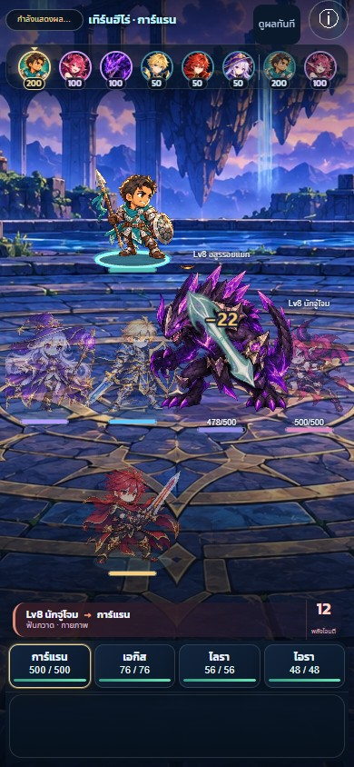

# C5.1 — ฟันดาบ / แทง (Blade family)

26 ตุลาคม 2026 · **R4 ผ่านเจ้าของและ merge เข้าเกมแล้ว 2026-10-26 (`d14a3e1`, PR #59) — ยังไม่เริ่มตระกูล 2**

เจ้าของอนุมัติให้ใช้ [แบบภาพเฉพาะ 10 ท่า](../blade-storyboards/README_TH.md) รวม Pierce R2 หอกหนา แล้วสั่งทำเป็น VFX จริง ชุด R4 จึงใช้ภาพเตรียม/ปะทะ/สลายที่เลือกไว้โดยตรง แพ็กเป็น atlas เดียว 38 frames ขนาด 1584×1848px (WebP 547,354 bytes) ไม่มีการสร้างภาพใหม่ แหล่งต้นฉบับและ SHA-256 ใน `incoming/ART-VFX-BLADE-001/production-sources.json` และแพ็กซ้ำด้วย `package-approved.py`

ก่อน contact แสดงภาพเตรียมที่ผู้ใช้ เมื่อถึง cue เดิมจึงแสดงภาพปะทะที่ผู้รับจริงพร้อมแกนเล็ก 10–18px เคลื่อนหนึ่งจังหวะแล้ว crossfade ไปภาพสลายเฉพาะท่า อายุภาพ 255–310ms และไม่เกินเวลาที่เหลือของ stage ตัวเลขอยู่เหนือภาพเสมอ ภาพปะทะมี peak alpha .88; ภาพสลายค่อยลดจาก .5; มีเศษแสงตกแต่ง 0–2 ชิ้น ความเข้มลดลงลดพื้นที่ 10% และไม่มีเศษแสง OS reduced motion ใช้ภาพปะทะนิ่งโดยไม่มี tween

| ท่า | เอกลักษณ์ของคมและการเคลื่อน |
|---|---|
| Attack | ฟันเฉียงสั้น กะทัดรัด หมุนส่งปลายคมเล็กน้อย |
| Finisher | คมยาวตั้งเฉียง กดลงจากบน พร้อมแกนปะทะที่แน่นกว่าท่าปกติ |
| Lunge | ลิ่มเรียวพุ่งตามแกนเข้าหาเป้าหมาย ระยะเคลื่อนมากกว่า Pierce |
| Sweep | เสี้ยวโค้งกว้างและแบน กวาดตามแนวนอนของจอที่ผู้รับจริงแต่ละตัว |
| Backstab | ปลายสั้นแทงย้อนเข้าจากฝั่งตรงข้ามของผู้รับ |
| Ambush | คมโค้งฟันเสยจากล่างขึ้นบน |
| Disarm | ตะขอคมเล็กยกสูง หมุนเกี่ยวออก ไม่มีเศษแสง |
| Parry | เสี้ยวคมสั้นหมุนสวนกลับ เฉพาะ counter จริงหลังตั้งท่า |
| Pierce | หัวหอกใบยาวและแกนหนารุ่น R2 ชี้ตามแกนผู้โจมตี–ผู้รับ ความยาว 130px และหน้าตัด 1.4 เท่าแบบที่เลือก |
| Halt | ปลายสั้นฐานกว้าง หยุดแน่นด้านหน้าตัว ระยะเคลื่อนน้อย ไม่มีเศษแสง |

ท่าฟันใช้ระนาบจอเพื่อไม่ให้ Sweep กลายเป็นแนวแทงตามตำแหน่งสนาม ส่วนท่าแทงใช้แกนผู้โจมตี–ผู้รับ Reduced motion คงสัดส่วนและแนวของแต่ละท่าเป็นภาพนิ่ง ผล blocked/dodged ยังอ่านจาก event และมีภาพเฉพาะผลนั้น

ภาพร่วมชุดเดียว `public/assets/fx/blade_fx.webp` + `.json` และโมดูล `src/game/visuals/blade-fx.ts` ตารางเล็กเลือกภาพ ขนาด ทิศ และการเคลื่อนของท่า ส่วน contact/deflect/flecks เป็นชั้นร่วม ไม่เพิ่ม atlas หรือโมดูลแยกรายสกิล ใช้สีเดิมที่เลือกไว้สำหรับอาชีพเจ้าของ และ tint ตามตระกูล icon เมื่อใช้ภาพ Attack ร่วมกับอาชีพอื่น

ก่อน contact มีประกายเล็กที่ต้นทาง; เมื่อถึง contact เดิมจึงเห็นรอยฟัน/แทงกับดาวเล็กที่ผู้รับจริง แล้วสลาย เศษแสงไม่ใช่การตีเพิ่ม ไม่เปลี่ยน `battle-playback.ts`, resolver, กฎ, balance หรือเซฟ ภาพเป็น normal alpha ไม่มี full-screen flash หรือสีขาวทับร่าง

เปิด [หน้าดูคลิป R4 เลือกทีละท่า](index.html) หรือใช้ลิงก์ด้านล่าง

## คลิป 390 × 844

| สกิล | คลิปโดนจริง |
|---|---|
| Attack | [attack-hit-normal](attack-hit-normal-390.mp4) |
| Finisher | [finisher-hit-normal](finisher-hit-normal-390.mp4) |
| Lunge | [lunge-hit-normal](lunge-hit-normal-390.mp4) |
| Sweep | [sweep-hit-normal](sweep-hit-normal-390.mp4) |
| Backstab | [backstab-hit-normal](backstab-hit-normal-390.mp4) |
| Ambush | [ambush-hit-normal](ambush-hit-normal-390.mp4) |
| Disarm | [disarm-hit-normal](disarm-hit-normal-390.mp4) |
| Parry | [parry-hit-normal](parry-hit-normal-390.mp4) — ตั้งท่าก่อน แล้วฟันสวนเมื่อ enemy stage มี Parry + counter จริง |
| Pierce | [pierce-hit-normal](pierce-hit-normal-390.mp4) |
| Halt | [halt-hit-normal](halt-hit-normal-390.mp4) |

ภาพกายภาพฝั่งศัตรูใช้ชุดเดียวกัน จึงตรวจผลที่มีจริงใน resolver ได้โดยไม่สร้างเหตุการณ์หลบหรือโล่ให้ศัตรูขึ้นมาเอง:

- [โล่รับเต็ม](attack-blocked-normal-390.mp4): เสี้ยวแสงมุกที่ขอบด้านผู้โจมตี ไม่มีรอยฟัน/ดาวบนร่าง ไม่มี body tint
- [โล่รับบางส่วน](attack-partial-normal-390.mp4): เห็นขอบโล่และผลต่อ HP ตาม amount/absorbed จริง
- [หลบ](attack-dodged-normal-390.mp4): ริ้วผ่านนอกตัว ไม่มีดาวปะทะ
- [Guard รับแทน](attack-guarded-normal-390.mp4): ภาพติดผู้รับ damage จริง พร้อมข้อความรับแทนเดิม
- [ยกเลิกเพราะขัดจังหวะ](attack-cancelled-normal-390.mp4): ไม่มีรอยฟันหรือปะทะล่าช้าจากศัตรูที่ถูกยกเลิก
- [Fast](lunge-hit-fast-390.mp4), [ความเข้มลดลง](lunge-hit-reduced-390.mp4), [OS reduced motion](lunge-hit-osreduce-390.mp4): ใช้ cue เดิม; OS reduced motion ใช้เฟรมนิ่งทันที ไม่มี tween ของภาพชุดนี้

คลิปเป็นเวลาจริงจาก Chromium headless / SwiftShader บน Windows ผ่าน fixture ทดสอบที่ใช้ BattleUI, BattleScene, playback และ resolver จริง ปรับทีม/ความเร็ว/HP และเงื่อนไขเริ่มต้นเฉพาะใน fixture เพื่อเรียกทุกสกิลและผลอย่างแน่นอน ไม่ใช่เซฟหรือค่าความสมดุลในเกม ไม่ใช่หลักฐานจาก iPhone/Safari หรือเครื่องจริง ไม่มีการ interpolate เฟรมหรือเร่ง/ชะลอวิดีโอ; `clips.json` บอกขนาด ระยะเวลา จำนวนเฟรม ช่องว่างเฟรม และเวลา impact ที่ renderer ได้รับจริง ภาพ contact เลือกจาก cue นี้ +70ms ไม่ประมาณจากเวลาที่แตะปุ่มซึ่งยังมีงาน layout คั่นอยู่

## ตรวจซ้ำ

```text
npm run typecheck
npm run lint
npx vitest run --maxWorkers=1
npm run build
npx playwright test tests/browser/blade-fx.spec.ts tests/browser/combat.spec.ts tests/browser/presentation.spec.ts tests/browser/bolt-fx.spec.ts tests/browser/exec-ward-fx.spec.ts --output test-results/blade-r4-final
```

อัดซ้ำใน PowerShell (อย่าอัดพร้อม simulation หรือ browser suite อื่น):

```powershell
$env:FX_CLIPS='1'
npx playwright test tests/browser/blade-clips.spec.ts --output test-results/blade-r4-delivery
python tests/browser/fixtures/encode-blade-clips.py test-results/blade-r4-delivery
```

ใช้ Python ที่มี Pillow และ ffmpeg/ffprobe ใน PATH การ pack atlas: `python incoming/ART-VFX-BLADE-001/package-approved.py`

ผลตรวจ R4: typecheck / lint / build และ **838/838 Vitest tests (71 files) ผ่าน**; family browser **28/28 ผ่าน** ครอบคลุม HP ก่อน/ตรง contact, ภาพเฉพาะท่า/สลาย, สัดส่วนหอกหนา, Backstab แทงย้อน, ตัวเลขอยู่เหนือภาพ และ cleanup ภาพจริงจาก blocked/partial/dodge/Guard/cancel ไม่มี core หรือคมบนตัวเมื่อไม่โดน ตรวจ OS reduced motion ของทั้ง 10 ท่าว่าเป็นภาพนิ่ง รวมการปรับความเร็ว/ความเข้ม/resize ตามเดิม

Regression battle/Bolt/Execute/Ward/playback ตรวจครบ 81 กรณี: ชุดใหญ่ผ่าน 78/81 มี 3 timeout พร้อม browser/server disconnect ใน log; รัน playback ทั้งไฟล์ใหม่โดยไม่แก้โค้ดหรือ timeout **13/13 ผ่าน** จึงตรวจครบทุกกรณี รวม family เป็น 109 กรณีที่ผ่านอย่างน้อยหนึ่งรอบ ตรวจ bounds/alpha ของ 38 frames จาก WebP ที่ decode แล้วตรงกับ cell PNG ทุกเฟรม และ SHA-256 ของต้นฉบับที่เลือกทั้ง 10 ไฟล์ตรงกัน

ฐานเกมรวม C12 batch 1 (`e79e8a4`) แล้ว การเปลี่ยนกฎ/เซฟของ C12 เป็นของ base branch งาน VFX ไม่แก้ `src/core`, `src/content` หรือ `battle-playback.ts` เพิ่ม

ส่ง R4 ใหม่ครบ **18/18 คลิป** ขนาด 390×844px ทุกไฟล์ (172–189 captured frames ต่อคลิป) เปิดตรวจเฟรมปะทะทั้ง 10 ท่าที่ renderer cue +70ms โดยเฟรมใกล้สุดคลาดไม่เกิน 6ms และเปิดตรวจภาพ Pierce/Sweep ที่ส่งจริงแล้ว หน้าดูคลิปผ่านการเปิด/สลับวิดีโอ Pierce, Sweep, Dodge และ OS reduced motion โดย decoder ไม่พบ error; เป็น Chromium/SwiftShader emulation ไม่ใช่การตรวจอุปกรณ์จริงหรือ Safari

## ภาพ contact จากการอัดจริง




เจ้าของตัดสินคุณภาพภาพจากคลิปก่อนอนุมัติขยายตระกูลถัดไป ผลเทสต์ไม่ใช่การอนุมัติภาพ

## ผลรวมกับ animation และ loading ล่าสุด

รวมฐาน `df16f3e` โดยคง unit poses ก่อนเริ่ม blade cast และคง contact/reaction poses ของฐานเดิม ผลล่าสุด: typecheck/lint/build, 858 unit tests, 46 focused browser tests ผ่าน; CI ที่ head `09c6357` ผ่าน source fixture 28, prechecks 3 และ production 249 / 84 skips หลักฐาน merge/เผยแพร่: [blade-vfx-release](../../validation/blade-vfx-release/README_TH.md)

เผยแพร่ R4 สำเร็จ: [Pages run40348106389](https://github.com/wnau34-nptrn/asterveil-fateweave/actions/runs/40348106389) ครบ build/4shards/deploy สำหรับ merge `d14a3e1`; ไฟล์ VFX บนเว็บตอบ200และ SHA-256 ตรงกับไฟล์ที่ทดสอบ
