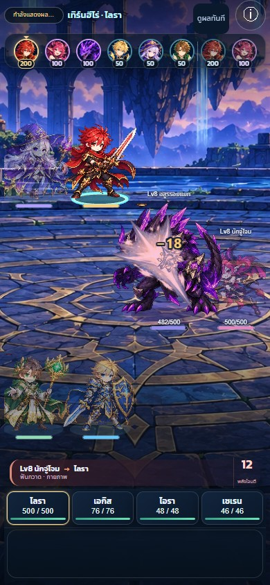
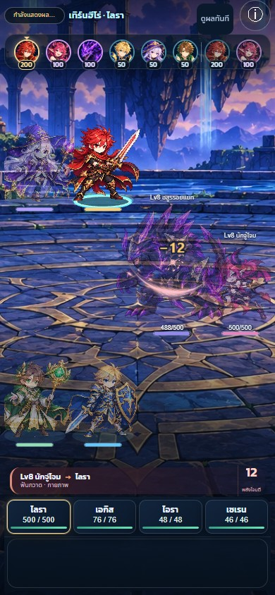

# C5.1 — ฟันดาบ / แทง (Blade family)

24 ตุลาคม 2026 · **R3 ลดความหนาจาก R2 และแยกเอกลักษณ์ทั้ง 10 ท่า — รอเจ้าของตรวจคลิปใหม่ ยังไม่อนุมัติภาพ และยังไม่เริ่มตระกูล 2**

เจ้าของเห็นว่า R2 หนาเกินไปและแต่ละท่าคล้ายกัน จึงปรับสัดส่วนและการเคลื่อนจากภาพร่วมชุดเดิม ไม่สร้างภาพใหม่หรือใช้ Shado ในรอบนี้ พีกของคมเหลือ alpha .82 จาก 1, ดาวปะทะ .78 และขนาด 30–50px จาก 64px; อายุคม 235–300ms จาก 350ms และไม่เกินเวลาที่เหลือของ stage ลดเศษแสงเหลือ 0–2 ชิ้น ขณะ contact มีคมต่อเนื่องเพียงหนึ่งจังหวะกับดาวที่ผู้รับจริง ไม่เพิ่มการโดน ไม่แก้ Bolt/Execute/Ward

| ท่า | เอกลักษณ์ของคมและการเคลื่อน |
|---|---|
| Attack | ฟันเฉียงสั้น กะทัดรัด หมุนส่งปลายคมเล็กน้อย |
| Finisher | คมยาวตั้งเฉียง กดลงจากบน พร้อมแกนปะทะที่แน่นกว่าท่าปกติ |
| Lunge | ลิ่มเรียวพุ่งตามแกนเข้าหาเป้าหมาย ระยะเคลื่อนมากกว่า Pierce |
| Sweep | เสี้ยวโค้งกว้างและแบน กวาดตามแนวนอนของจอที่ผู้รับจริงแต่ละตัว |
| Backstab | ปลายสั้นแทงย้อนเข้าจากฝั่งตรงข้ามของผู้รับ |
| Ambush | คมโค้งฟันเสยจากล่างขึ้นบน |
| Disarm | ตะขอคมเล็กยกสูง หมุนเกี่ยวออก ไม่มีเศษแสง |
| Parry | เสี้ยวคมสั้นหมุนสวนกลับ เฉพาะ counter จริงหลังตั้งท่า |
| Pierce | เข็มยาวบางที่สุด ชี้ตามแกนผู้โจมตี–ผู้รับ |
| Halt | ปลายสั้นฐานกว้าง หยุดแน่นด้านหน้าตัว ระยะเคลื่อนน้อย ไม่มีเศษแสง |

ท่าฟันใช้ระนาบจอเพื่อไม่ให้ Sweep กลายเป็นแนวแทงตามตำแหน่งสนาม ส่วนท่าแทงใช้แกนผู้โจมตี–ผู้รับ Reduced motion คงสัดส่วนและแนวของแต่ละท่าเป็นภาพนิ่ง ผล blocked/dodged ยังอ่านจาก event และมีภาพเฉพาะผลนั้น

ภาพร่วมชุดเดียว `public/assets/fx/blade_fx.webp` + `.json`, โมดูล `src/game/visuals/blade-fx.ts`, ต้นฉบับและ prompt ใน `incoming/ART-VFX-BLADE-001/` ใช้ภาษาเส้นโค้งปลายเรียว แกน ivory ขอบสีตามอาชีพ เหมือน Bolt / Execute / Ward ที่ผ่านแล้ว ทุกสกิลเลือกทรง ขนาด ทิศ และจำนวนเศษแสงจากตารางเล็ก ไม่มีภาพแยกรายสกิล

ก่อน contact มีประกายเล็กที่ต้นทาง; เมื่อถึง contact เดิมจึงเห็นรอยฟัน/แทงกับดาวเล็กที่ผู้รับจริง แล้วสลาย เศษแสงไม่ใช่การตีเพิ่ม ไม่เปลี่ยน `battle-playback.ts`, resolver, กฎ, balance หรือเซฟ ภาพเป็น normal alpha ไม่มี full-screen flash หรือสีขาวทับร่าง

## คลิป 390 × 844

| สกิล | คลิปโดนจริง |
|---|---|
| Attack | [attack-hit-normal](attack-hit-normal-390.mp4) |
| Finisher | [finisher-hit-normal](finisher-hit-normal-390.mp4) |
| Lunge | [lunge-hit-normal](lunge-hit-normal-390.mp4) |
| Sweep | [sweep-hit-normal](sweep-hit-normal-390.mp4) |
| Backstab | [backstab-hit-normal](backstab-hit-normal-390.mp4) |
| Ambush | [ambush-hit-normal](ambush-hit-normal-390.mp4) |
| Disarm | [disarm-hit-normal](disarm-hit-normal-390.mp4) |
| Parry | [parry-hit-normal](parry-hit-normal-390.mp4) — ตั้งท่าก่อน แล้วฟันสวนเมื่อ enemy stage มี Parry + counter จริง |
| Pierce | [pierce-hit-normal](pierce-hit-normal-390.mp4) |
| Halt | [halt-hit-normal](halt-hit-normal-390.mp4) |

ภาพกายภาพฝั่งศัตรูใช้ชุดเดียวกัน จึงตรวจผลที่มีจริงใน resolver ได้โดยไม่สร้างเหตุการณ์หลบหรือโล่ให้ศัตรูขึ้นมาเอง:

- [โล่รับเต็ม](attack-blocked-normal-390.mp4): เสี้ยวแสงมุกที่ขอบด้านผู้โจมตี ไม่มีรอยฟัน/ดาวบนร่าง ไม่มี body tint
- [โล่รับบางส่วน](attack-partial-normal-390.mp4): เห็นขอบโล่และผลต่อ HP ตาม amount/absorbed จริง
- [หลบ](attack-dodged-normal-390.mp4): ริ้วผ่านนอกตัว ไม่มีดาวปะทะ
- [Guard รับแทน](attack-guarded-normal-390.mp4): ภาพติดผู้รับ damage จริง พร้อมข้อความรับแทนเดิม
- [ยกเลิกเพราะขัดจังหวะ](attack-cancelled-normal-390.mp4): ไม่มีรอยฟันหรือปะทะล่าช้าจากศัตรูที่ถูกยกเลิก
- [Fast](lunge-hit-fast-390.mp4), [ความเข้มลดลง](lunge-hit-reduced-390.mp4), [OS reduced motion](lunge-hit-osreduce-390.mp4): ใช้ cue เดิม; OS reduced motion ใช้เฟรมนิ่งทันที ไม่มี tween ของภาพชุดนี้

คลิปเป็นเวลาจริงจาก Chromium headless / SwiftShader บน Windows ผ่าน fixture ทดสอบที่ใช้ BattleUI, BattleScene, playback และ resolver จริง ปรับทีม/ความเร็ว/HP และเงื่อนไขเริ่มต้นเฉพาะใน fixture เพื่อเรียกทุกสกิลและผลอย่างแน่นอน ไม่ใช่เซฟหรือค่าความสมดุลในเกม ไม่ใช่หลักฐานจาก iPhone/Safari หรือเครื่องจริง ไม่มีการ interpolate เฟรมหรือเร่ง/ชะลอวิดีโอ; `clips.json` บอกขนาด ระยะเวลา จำนวนเฟรม ช่องว่างเฟรม และเวลา impact ที่ renderer ได้รับจริง ภาพ contact เลือกจาก cue นี้ +70ms ไม่ประมาณจากเวลาที่แตะปุ่มซึ่งยังมีงาน layout คั่นอยู่

## ตรวจซ้ำ

```text
npm run typecheck
npm run lint
npx vitest run --maxWorkers=1
npm run build
npx playwright test tests/browser/blade-fx.spec.ts tests/browser/presentation.spec.ts --output test-results/blade-r3-final
```

อัดซ้ำใน PowerShell (อย่าอัดพร้อม simulation หรือ browser suite อื่น):

```powershell
$env:FX_CLIPS='1'
npx playwright test tests/browser/blade-clips.spec.ts --output test-results/blade-r3-delivery
python tests/browser/fixtures/encode-blade-clips.py test-results/blade-r3-delivery
```

ใช้ Python ที่มี Pillow และ ffmpeg/ffprobe ใน PATH การ pack atlas: `python incoming/ART-VFX-BLADE-001/package.py`

ผลตรวจ R3 จะบันทึกหลังตรวจชุดสุดท้าย: family tests ตรวจ HP ก่อน/ตรง contact, valid atlas frames, พีกที่ contact +80ms อยู่ระหว่าง alpha .7–.9, สัดส่วน Sweep/Pierce/Halt และทิศ Backstab จากภาพที่ render จริง, ตัวเลขอยู่เหนือแสง, skip cleanup, ผลจริงและ fast/reduced/resize รวมความกว้าง 320/390/1366px ตั้งนาฬิกาทดสอบก่อนเริ่ม Phaser เพื่อไม่เปลี่ยน clock กลาง render loop

Vitest บนฐานเกมล่าสุด `a8cf3c7`, `npx vitest run --maxWorkers=1`: **756/756 ผ่าน (65 files)** ไม่มีการแก้ test timeout/กฎ/ตัวเลข ไฟล์ `src/core`, `src/content` และ `battle-playback.ts` ไม่ต่างจาก base branch

## ภาพ contact จากการอัดจริง





เจ้าของตัดสินคุณภาพภาพจากคลิปก่อนอนุมัติขยายตระกูลถัดไป ผลเทสต์ไม่ใช่การอนุมัติภาพ
