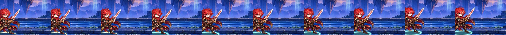
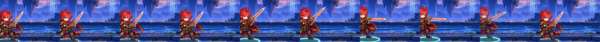

# LYRA-002 — ท่า Mark และ Parry stance ของไลรา (AV02 ส่วนที่เหลือ)

วันที่ 2026-10-30 · ภาพ Codex PR #114 (`art/art-unit-animation-lyra-002` @ `cd8a9d7`, R1 ชุดเดียว) · เจ้าของเลือก “เอาตามที่คุณแนะนำ” = นำ R1 เข้าเกมแล้วตัดสินจากคลิปจริง · **รอเจ้าของอนุมัติ motion**

## สิ่งที่เปลี่ยน

- `incoming/ART-UNIT-ANIMATION-LYRA-002/build_assets.py`: แปลง cell 1024×640 ของ Codex ด้วย transform เดียวทั้งชุด (scale .5 วางที่ (0,208)) ซึ่งตรงกับ seed ของ pilot (อัลฟาต่างเฉลี่ย 0.005 ที่ขอบ anti-alias) — เฟรมต้น/ท้ายใช้พิกเซลของ idle เดิม (frame 0) จึงไม่มีการกระโดดเข้า/ออกท่า; ต่อเป็นเฟรม 22–29 (Mark) และ 30–37 (Parry stance) แล้ว pack lossless ใหม่ เฟรม 0–21 เดิมตรงทุกพิกเซล (ตรวจแล้ว)
- registry `tracer`: `mark` → prepare 23–25 / recover 26–29, `parry` → prepare 31–33 / recover 34–37 (contact = เฟรมแรกของ recover ซึ่งเท่ากับท่าค้าง 25=26, 33=34) ใช้ pose เดิม (`cast` / `guard`) และเวลา UI เดิม; riposte ของ Parry (12→13) คงเดิม
- ไม่เปลี่ยน rules/save/content/balance/ActionId/contact/end; reduced motion ยังไม่เล่นเฟรม (เหมือนทุก clip)

## งบภาพ (ต้องแจ้งเจ้าของ)

atlas `lyra` 38 เฟรม (27 ภาพไม่ซ้ำ) 1280×1743: decoded 8.51 MiB, download 2.31 MB — เกินแนวทางตัวทั่วไป (~6 MiB / ~1.5 MB) และใกล้งบบอส; เดิม 5.91 MiB / 1.54 MB. ลดแล้วด้วย dedup เฟรมซ้ำ, ตัดอัลฟาจาง และ pack 84% ไม่ลดคุณภาพภาพ; encounter รวมยังต่ำกว่า 64 MiB มาก. ทางเลือกถ้าต้องการลด: แยกท่า Mark/Parry เป็น sheet ที่โหลดเฉพาะเมื่อไลราติดสกิลนั้น (งานเพิ่ม)

## หลักฐาน (Chromium SwiftShader 390×844 — ไม่ใช่มือถือจริง/iOS Safari)

คลิปนาฬิกาจริงจาก harness ของ audit (`../../validation/animation-vfx-full-audit-2026-10-29/repro/live.cjs`, กรณี `hero-tracer-mark`, `hero-tracer-parry`, `counter-tracer-parry`) ก่อน = `6034de4`, หลัง = branch นี้:

| กรณี | ก่อน | หลัง |
| --- | --- | --- |
| Mark | [mp4](hero-tracer-mark-before.mp4) ·  | [mp4](hero-tracer-mark-after.mp4) ·  |
| Parry stance | [mp4](hero-tracer-parry-before.mp4) ·  | [mp4](hero-tracer-parry-after.mp4) ·  |
| Parry riposte (ไม่เปลี่ยน) | [mp4](counter-tracer-parry-before.mp4) | [mp4](counter-tracer-parry-after.mp4) |

ผลที่เห็น: Mark ยกดาบ → ชี้ปลายดาบระดับอกค้าง → คืนท่า อ่านออกว่า "กำหนดเป้า" ไม่ใช่ฟัน/แทง; Parry ย่อเข่า ตั้งดาบขวางหน้าค้างแล้วคลาย — ต่างจาก idle ด้วยการย่อตัวเป็นหลัก (seed ถือดาบเฉียงอยู่แล้ว) จุดนี้ให้เจ้าของตัดสิน

เทสต์: typecheck, lint, vitest เต็ม 1356 ผ่าน, build ผ่าน, Playwright unit-loading + unit-a1 + blade-fx 51/51
