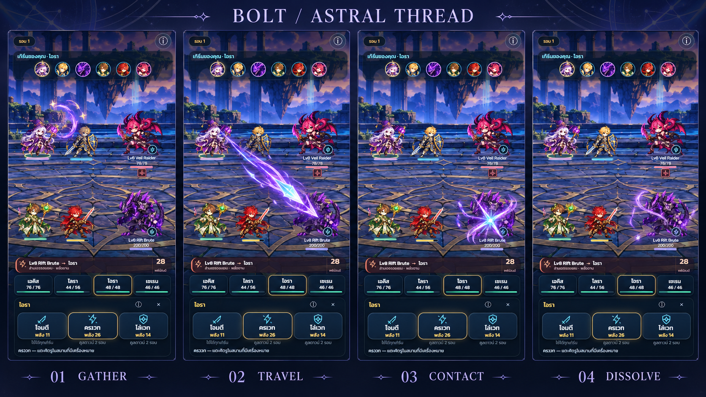
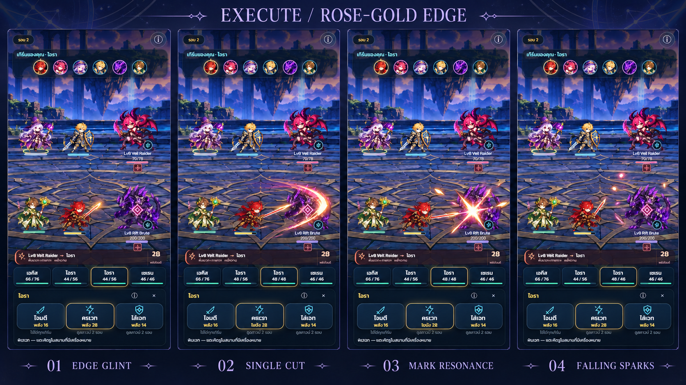
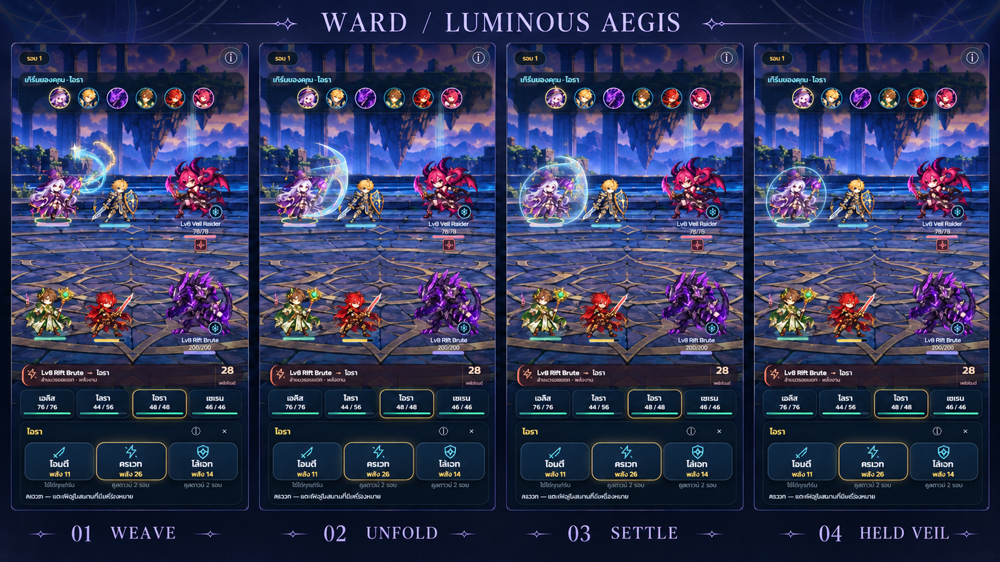

# VFX art direction v1 — artwork ก่อนขยายระบบ

วันที่ 21 ตุลาคม 2026 · **สถานะ: concept เสนอให้เจ้าของตรวจ ยังไม่ผ่านการยืนยันงานภาพ และยังไม่ใช่ runtime assets**

เจ้าของไม่พอใจความสวยของ VFX เฟส 2 และอนุญาตให้ Codex ทำ mockup/storyboard เพื่อส่งให้ Claude พัฒนาต่อ จึงเปลี่ยนลำดับจากเริ่มฉากบอสทันที เป็นตรวจภาษาภาพ → ทำ Bolt ตัวอย่างหนึ่งสกิล → ตรวจคลิปจริง → ขยายสกิล → กลับเข้าเฟส 3

ระบบเฟส 2 ส่งมอบแล้ว แต่ **ไม่ถือว่าคุณภาพภาพได้รับการยอมรับ** อย่าใช้ผล unit/browser tests เป็นหลักฐานว่างานภาพสวยหรือเจ้าของอนุมัติ

## ภาพเสนอ

ภาพละ 4 จังหวะ บนสนามเกมจริงที่ใช้เป็น reference; ทุก storyboard มีขนาดจริง **1672×941px** ภาพอ้างอิงต้นฉบับ **390×844px** ดู manifest สำหรับขนาด/ไฟล์

### Bolt — Astral Thread

รวมพลัง → ลูกพลังเคลื่อน → ประกายปะทะ → หางแสงสลาย ใช้แกนฟ้าขาวกับม่วงอ่อน เป็นพลังรูปเข็ม/ดาวที่มีหางเรียว ให้เห็นทิศทางและจุดหมายชัด ไม่ใช่วงกลมวิ่งบนเส้นตรง

### Execute — Rose-Gold Edge

คมดาบติดแสง → ฟันโค้งหนึ่งครั้ง → ตราตอบสนอง → ประกายตก ใช้ทองอ่อน/ivory กับขอบชมพูสัมพันธ์กับ Mark ไม่ใช่ไฟ ตราต้องยังอยู่ตามสถานะจริง ไม่ทำภาพว่าถูกใช้หมดหรือแตกหาก resolver ไม่ได้ลบ

### Ward — Luminous Aegis (ชื่อแนวภาพ ไม่เปลี่ยนชื่อสกิล/ตัวละคร)

ถักเส้นแสง → ม่านโค้งคลี่ → เกราะพลังตั้งตัว → เหลือขอบบาง ใช้ cyan มุกกับรายละเอียดทองจาง มองผ่านกลางโล่เห็นตัวละคร เป็นม่านโค้งมี volume ไม่ใช่ไอคอนโล่ห้าเหลี่ยม ภาพนี้ร่ายใส่ Mage เอง ไม่ใช่ฉากศัตรูโจมตี/โล่แตก/ฮีล

## วิธีอ่านและข้อคลาดเคลื่อนที่ต้องแก้ในการทำจริง

- ใช้ storyboard เป็น reference ของ **shape, palette, layering, spatial footprint และลำดับ** เท่านั้น ภาพเป็นการสร้างด้วย AI และมีการวาดซ้ำ ไม่ใช่ pixel-exact composite หรือ screenshot จาก implementation ใหม่
- พบว่า Execute วาดปุ่ม/ชื่อสกิลด้านล่างคลาดไปเป็นชุด Mage, บางค่า HP/ตัวอักษรไทยคลาดเคลื่อน และ Ward มี highlight ปุ่มไม่ตรง source **ห้ามนำ UI, ตัวเลข, ค่าเกม, pose ที่วาดคลาด หรือ sprite ตัวละครจากภาพ generated ไปแทนของเดิม** Source ทั้งสามภาพใน `references/` และ DOM/asset จริงในเกมเป็นข้อมูลอ้างอิงที่ถูกต้อง
- Bolt panel02 แสดง wake ยาวเพื่อสื่อทิศทาง ใน runtime ต้องเป็น **หัวลูกพลังเคลื่อนที่พร้อมหางจำกัดความยาว** ไม่ใช่คานเลเซอร์ค้างจากผู้ใช้ถึงเป้า และไม่สื่อว่าตีหลายครั้ง
- เป็น PNG sheet ทึบที่รวมฉากและ UI แล้ว **ไม่ใช่ transparent sprite/atlas** ห้าม crop พื้นหลังติดมาทำ texture ในเกม ต้องสร้าง effect-only layers แยกใหม่หลังตกลงแนวภาพ
- รูปลักษณ์/pose/กล้อง/ฉากเดิมเป็นสิ่งที่ต้องรักษาใน runtime ไม่ใช้ภาพ generated เป็นคำสั่งให้เปลี่ยนตัวละครหรือสถานที่
- ภาพนิ่งและการเห็นเอฟเฟกต์ชัดไม่ยืนยันคุณภาพการเคลื่อนไหว, FPS หรือเสียงบนเครื่องจริง ต้องตรวจคลิป Bolt จากเกมก่อนขยาย

## ภาษาภาพร่วม

| ส่วน | แนวทาง |
|---|---|
| โครงหลัก | เส้น/กลีบ/แผ่นพลังที่วาดรูปทรงอย่างตั้งใจ ปลายเรียว น้ำหนักไม่สม่ำเสมอ มีพื้นที่โปร่ง |
| ชั้นแสง | core คมขนาดเล็ก → colored edge → soft glow ต่ำ → sparks จำนวนน้อย |
| จุดปะทะ | อยู่ที่ body-contact ของผู้รับจริงตาม event ไม่อยู่ใต้เท้า และไม่ใช้ flash ขาวทับทั้งตัว |
| ปริมาณ | ให้ตัวละครยังเป็นสิ่งหลัก เอฟเฟกต์มี peak สั้นแล้วลดรายละเอียด ไม่เพิ่ม particles เพื่อแก้ shape ที่ไม่ดี |
| สี | Bolt ฟ้าขาว/ม่วง; Execute ivory/ทอง/ชมพู; Ward cyan มุก/ทองจาง คงสีเขียวมิ้นต์ไว้สำหรับ Heal |
| ข้อมูลเกม | ตัวเลข/HP/status ใช้ live UI จาก resolver เสมอ ไม่ฝังไว้ใน texture |
| งดใช้เป็น final | เส้นตรงหนาตลอดเส้น, วงขยายสม่ำเสมอทุกสกิล, โล่ polygon แบน, tint ขาวทับร่าง, full-screen bloom/flash |

## Timing สำหรับตัวอย่างแรก

คง contact/end ปกติเดิมเพื่อเปลี่ยนภาพโดยไม่เปลี่ยนระบบ ภาพ 4 ช่องไม่จำเป็นต้องใช้เวลาเท่ากัน ปรับรายละเอียดระหว่าง cue ได้ แต่ทุกผลและเสียง impact ต้องลงที่ contact เดิม

| สกิล | เตรียม | เคลื่อน/คลี่ | contact | สลาย/คืนความอ่านง่าย | จบ stage |
|---|---|---|---|---|---|
| Bolt | 0–100ms | 100–298ms | 298ms | 298–650ms; rest650–850 | 850ms |
| Execute | 0–150ms | 150–298ms | 298ms | 298–650ms; rest650–850 | 850ms |
| Ward | 0–100ms | 100–260ms | 260ms | settle260–420; held420–650 | 650ms |

Fast ใช้เวลา 65% ผ่าน `stageTiming` เดิม ไม่ hard-code ตัวเลขชุดที่สอง OS reduced-motion ให้ผลจริงทันทีที่เริ่ม stage พร้อมรูป/ข้อความนิ่ง ไม่บังคับดูการวิ่งของลูกพลัง

## Anchor / scale / composition

- ใช้ CSS pixels และ `actorPanels`/body anchors เดิม ไม่ใช้พิกัดใน storyboard และไม่ใช้ viewport desktop เป็นฐาน
- Source Bolt: มือ/ปลาย staff ของ Mage; target: body-contact ของ `damage`/`dodge` recipient จริง รวม Guard redirect ศัตรูตัวอื่นไม่รับผล
- Execute: ต้นทาง blade ของ Duelist; ใช้คมฟันโค้งหนึ่งครั้งรอบผู้รับจริง ไม่ใช้ X-slash ที่สื่อการตีสองครั้ง Mark pulse เกิดเมื่อเงื่อนไข Mark→Execute เป็นจริง และไม่ลบ status เอง
- Ward: follow ตัวผู้ได้รับ barrier จริง ม่านไม่ทับเพื่อนข้างเคียง ใช้เส้นโค้งบางกับกลางโปร่ง ขอบ persistent แสดงได้เฉพาะเมื่อ barrier จริงยังมากกว่า0; down/load/resize ต้อง cleanup
- จุดเริ่มทดลองที่390px: Bolt head14–22px, tailประมาณ50–90pxและไม่ยาวเกินครึ่งทางเดิน; impact radiusประมาณ28–40px; Execute footprintใกล้ความกว้างหนึ่งตัว; Wardกว้างประมาณ55–65pxใน slot ของผู้รับ ปรับตาม slot/จอ320pxหลังดูจริง ค่าเหล่านี้เป็นข้อเสนอด้านภาพ ไม่ใช่กฎต่อสู้
- หน้าตัวละครและเงาร่างต้องเห็นชัดแม้ contact; glow/sparks ห้ามทับ HUD/dock/queue และไม่เปลี่ยนตำแหน่ง hit targets

## Layer brief สำหรับ Claude / งานผลิตหลังตรวจแบบ

| สกิล | ส่วนที่ควรแยก | Anchor / blending |
|---|---|---|
| Bolt | cast-thread, comet-core, tapered-wake, impact-petals, spark | core/tail axis ไปยังผู้รับจริง; additive เฉพาะแสง, normal-alpha ขอบสี; อย่าใช้ ADD จนรายละเอียดหาย |
| Execute | blade-glint, slash-ribbon, contact-star, rose-mark-pulse, falling-spark | origin/blade → local target footprint; markอ่านสถานะจริง |
| Ward | weave-thread, curved-veil, rim-crescent, sparse-rune, quiet-rim | local target body anchor; normal-alphaกลางโปร่งกับadditiveขอบบาง |

เริ่ม texture/flipbook ขนาดเล็กที่อ่านรูปได้จริง เช่น cell128–256px แล้วค่อย pack atlas หลังตรวจ clip ไม่กำหนดจำนวนเฟรม/ขนาด atlas จากภาพ sheet นี้ ต้องตรวจ alpha/fringes บนฉากสว่างและมืด เก็บ source/manifest/license metadata ของ asset ใหม่อย่างชัดเจน

## ลำดับส่งมอบต่อ

1. ให้เจ้าของตรวจ v1 ทั้ง3ภาพ เลือก/แก้ทิศทางก่อนอ้างว่า approved
2. หลังยืนยันแนวทาง ให้ Claude ทำ **Bolt เพียงสกิลเดียว** โดยใช้ระบบ phase1–2 ต่อ แยก layers ตาม brief ห้ามเอา sheet ทั้งแผ่นไปวางทับเกม
3. ส่งคลิป Bolt ที่390×844/320×568และPC พร้อม normal/fast/reduced; เปรียบเทียบ gather/travel/contact/dissolve กับแบบและตรวจภาพปะทะหลัง canvas paint จริง
4. ตรวจโดน HP, โดนโล่เต็ม/บางส่วน, Guard, dodge, cancel, down, skip/reload/hidden-tab/resize และผล/save เดิม ถ้าเป็น full block ห้ามทำ body-damage flash; impactแสดงที่โล่; cancelห้ามมีลูกพลังมาถึงภายหลัง
5. เจ้าของตรวจคลิปก่อนขยาย Execute/Ward/สกิลอื่น แล้วจึงกลับเข้าเฟส3ฉากบอส

## การตรวจและ provenance

- สร้างด้วย built-in `image_gen` โดยแก้ภาพเกมของโครงการนี้ ไม่มี CLI/API fallback ไม่มี asset จาก sibling project
- Input: synthetic QA screenshot ของ runtime เฟส2ที่เผยแพร่แล้ว ไม่ใช่เซฟของเจ้าของหรือข้อมูลส่วนตัว
- ทุกภาพถูกเปิดตรวจสายตาแล้ว ยืนยัน PNG dimensions จาก header และคัดลอกเข้าชุดนี้ครบ3boards+3sources; `image-manifest.json` ระบุขนาดจริง `generation-prompts.json` เก็บ prompt เต็มและโหมดที่ใช้
- ไม่มีการแก้ source/runtime/asset manifest ของเกม ไม่มีผลทดสอบ gameplay ใหม่ และไม่มีการ deploy ใหม่จากงานเอกสาร/ภาพนี้

ระหว่างจัดชุดส่งต่อ พบ remote เพิ่มงาน Chapters phaseA/B1, map/rules, savev28 และ lobby selection อย่างน้อยถึง6b05b9e ภาพอ้างอิงชุดนี้มาจากphase2ก่อนงานแคมเปญ จึงใช้สื่อภาษาภาพเท่านั้น ห้ามย้อน code/save/map ล่าสุดตามภาพหรือ baseline เก่า งานรอบนี้ต้องรวมแบบเอกสาร/ภาพโดยไม่มี runtime diff เทียบ remote ล่าสุด
