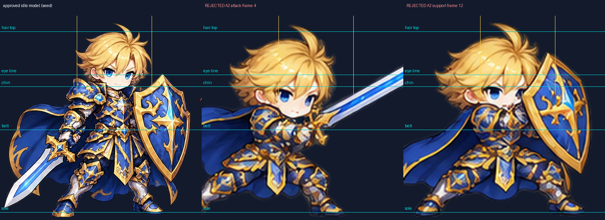
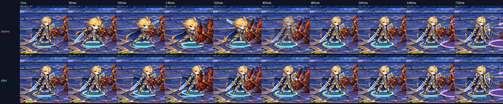
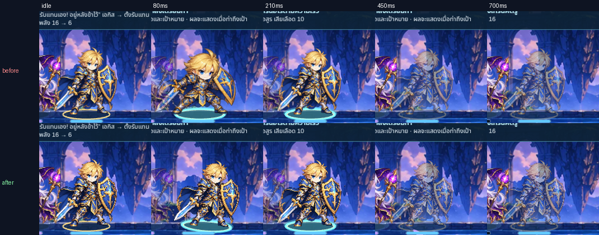

# แก้อาการหัวโต/ตัวเปลี่ยนสัดส่วนของอัศวิน Aegis

วันที่ 2026-10-29 (Asia/Bangkok) · ฐาน `157d6855` บน `feature/fateweave-initial-prototype` · ต่อจากรายงาน [animation-visual-audit-2026-10-29](../animation-visual-audit-2026-10-29/README_TH.md)
ขอบเขตตามที่เจ้าของสั่งระหว่างงาน: **แก้เฉพาะ Aegis** ไม่แตะตัวอื่น (Vargoth Guard ใช้เฟรม A2 เหมือนเดิมทุกอย่าง)

## ต้นเหตุ (ตรวจจากภาพจริง)

ไม่ได้มาจาก renderer, การ normalize ผิดเฟรม หรือ atlas สลับกัน ต้นเหตุอยู่ใน **ภาพต้นทาง**: ท่าที่ ImageGen สร้างใน `incoming/ART-UNIT-ANIMATION-A2-001/aegis-raw.png` วาด Aegis เป็น chibi คนละสัดส่วนกับ seed ที่อนุมัติ หัว/ผมใหญ่ขึ้น ไหล่และโล่กว้างขึ้น ขณะที่ความสูงรวมใกล้เดิม `build_assets.py` ใช้สเกลเดียวจากความสูง bbox ของท่าแรกในแถวเทียบ seed (ถูกต้องตามหลักสเกลเดียวทั้งแถว) จึงคงความสูงและฝ่าเท้าได้ แต่สัดส่วนภายในไม่มีทางตรงกัน

วัดด้วยเครื่องมือใหม่ `scripts/unit-anatomy-audit.py` (จับคู่ feature ของหัว/ใบหน้า/ไหล่ของ idle เข้ากับทุกเฟรม แล้ว fit similarity transform จึงไม่หลงกับการย่อตัว/ยื่นแขน): ค่ากลางสเกลหัวของเฟรม generated = **1.37 เท่าของ idle** วัดได้ 11 เฟรมในช่วง 1.25–1.41 (attack 2/3/4/7, support 10/11/14/15, bash 26/27/28) อีก 14 เฟรมจับ feature ได้ไม่พอ (หน้าถูกโล่บัง ท่าล้ม) จึง **ไม่ได้วัด ไม่นับว่าผ่าน** ดู [anatomy-audit-aegis-a2.json](anatomy-audit-aegis-a2.json)

normalization แก้ไม่ได้: ถ้าย่อให้หัวเท่า idle ตัวทั้งตัวจะเหลือราว 73% ถ้าคงความสูง หัวก็โต การบีบทีละเฟรม การขยาย idle ตามภาพผิด หรือการยืด dissolve ล้วนถูกห้ามและไม่แก้ต้นเหตุ

## สิ่งที่แก้แล้ว

1. **พักเฟรม A2 ของ Aegis ใน runtime (anatomy hold)** — `src/game/visuals/unit-frames.ts` เพิ่ม `anatomyHold = {'guardian'}` ทำให้ไม่โหลด atlas `aegis_a2` และไม่วาดท่า generated เลย อัศวินแสดงภาพนิ่ง seed ที่อนุมัติ (`battle-units` frame 0) พร้อมท่าขยับ procedural เดิม (พุ่ง/เอียง/ถอย/ล้ม) `BattleScene.framedClip` ไม่ส่ง clip ให้ตัวที่ถูกพัก จึงใช้ความยาว recover แบบ procedural ตามเดิมก่อน A2 mapping/atlas/ไฟล์ทั้งหมดยังอยู่ใน repository พร้อมใช้เมื่อได้ภาพใหม่
2. **brief ให้ Codex วาดใหม่** — [docs/handoffs/CODEX-AEGIS-ANATOMY-REDRAW-TH.md](../../handoffs/CODEX-AEGIS-ANATOMY-REDRAW-TH.md) (ART-UNIT-ANIMATION-A2-002, คิวข้อ 28): 25 ท่าบน model sheet `incoming/ART-UNIT-ANIMATION-A2-001/aegis-model-sheet-guides.png` สัดส่วนล็อกเป็นตัวเลข (หัว 140px ผมกว้าง 190px ใน canvas 512) ให้ Codex รันตัวตรวจสัดส่วนก่อนส่ง ช่องเฟรม/contact (5/13/26) คงเดิม
3. **ตัวตรวจสัดส่วน** — `scripts/unit-anatomy-audit.py` ใช้ได้ทั้ง atlas ที่ ship และโฟลเดอร์ cells ของ Codex (`--cells`) เป็นเครื่องมือ QA ไม่ใช่ CI gate; `not-measured` ไม่ใช่ผ่าน
4. **ตัวอัดหลักฐาน** — `tests/browser/aegis-anatomy-clips.spec.ts` (เปิดด้วย `AEGIS_ANATOMY_CLIPS=1`) รันโค้ดเดิมและโค้ดใหม่ด้วยสคริปต์เดียวกัน: ภาพนิ่งทุก 40ms ด้วย fixed clock + screencast เวลาจริง พร้อมตรวจผล resolver/commit; fixture เพิ่ม scenario `down` (Aegis HP 1 โดน Crushing Blow) เพื่อจับท่าล้มของ Aegis

ไม่เปลี่ยน rules, save, balance, content, ActionId, เวลา contact/end หรือ encounter version

## ภาพเคลื่อนไหวจาก runtime จริง (before = `157d6855`, after = งานนี้)

| เคส | before | after | ภาพเทียบ |
| --- | --- | --- | --- |
| attack 390 normal | [mp4](clips/attack-normal-RiftBolt-hero-normal-390-before.mp4) | [mp4](clips/attack-normal-RiftBolt-hero-normal-390-after.mp4) | [frames](frames/attack-normal-RiftBolt-hero-normal-390-frames.png) |
| attack 390 fast | [mp4](clips/attack-normal-RiftBolt-hero-fast-390-before.mp4) | [mp4](clips/attack-normal-RiftBolt-hero-fast-390-after.mp4) | [frames](frames/attack-normal-RiftBolt-hero-fast-390-frames.png) |
| attack 390 reduced (เกม) | [mp4](clips/attack-normal-RiftBolt-hero-reduced-390-before.mp4) | [mp4](clips/attack-normal-RiftBolt-hero-reduced-390-after.mp4) | [frames](frames/attack-normal-RiftBolt-hero-reduced-390-frames.png) |
| attack 390 OS reduce motion | [mp4](clips/attack-normal-RiftBolt-hero-osreduce-390-before.mp4) | [mp4](clips/attack-normal-RiftBolt-hero-osreduce-390-after.mp4) | [frames](frames/attack-normal-RiftBolt-hero-osreduce-390-frames.png) |
| attack 320×568 | [mp4](clips/attack-normal-RiftBolt-hero-normal-320-before.mp4) | [mp4](clips/attack-normal-RiftBolt-hero-normal-320-after.mp4) | [frames](frames/attack-normal-RiftBolt-hero-normal-320-frames.png) |
| attack PC 1366×1000 | [mp4](clips/attack-normal-RiftBolt-hero-normal-1366-before.mp4) | [mp4](clips/attack-normal-RiftBolt-hero-normal-1366-after.mp4) | [frames](frames/attack-normal-RiftBolt-hero-normal-1366-frames.png) |
| bash | [mp4](clips/bash-normal-RiftBolt-hero-normal-390-before.mp4) | [mp4](clips/bash-normal-RiftBolt-hero-normal-390-after.mp4) | [frames](frames/bash-normal-RiftBolt-hero-normal-390-frames.png) |
| guard | [mp4](clips/guard-normal-CrushingBlow-hero-normal-390-before.mp4) | [mp4](clips/guard-normal-CrushingBlow-hero-normal-390-after.mp4) | [frames](frames/guard-normal-CrushingBlow-hero-normal-390-frames.png) |
| hit (โดน Crushing Blow) | [mp4](clips/attack-normal-CrushingBlow-enemy-normal-390-before.mp4) | [mp4](clips/attack-normal-CrushingBlow-enemy-normal-390-after.mp4) | [frames](frames/attack-normal-CrushingBlow-enemy-normal-390-frames.png) |
| ถูกตีหลัง guard | [mp4](clips/guard-normal-CrushingBlow-enemy-normal-390-before.mp4) | [mp4](clips/guard-normal-CrushingBlow-enemy-normal-390-after.mp4) | [frames](frames/guard-normal-CrushingBlow-enemy-normal-390-frames.png) |
| counter (guardcounter) | [mp4](clips/guard-counter-CrushingBlow-enemy-normal-390-before.mp4) | [mp4](clips/guard-counter-CrushingBlow-enemy-normal-390-after.mp4) | [frames](frames/guard-counter-CrushingBlow-enemy-normal-390-frames.png) |
| down | [mp4](clips/attack-down-CrushingBlow-enemy-normal-390-before.mp4) | [mp4](clips/attack-down-CrushingBlow-enemy-normal-390-after.mp4) | [frames](frames/attack-down-CrushingBlow-enemy-normal-390-frames.png) |

ภาพเทียบใช้ crop เดียวกันทั้งสองแถว ป้ายเหลืองคือ texture:frame ที่วาดจริงในเฟรมนั้น ([captures.json](captures.json)): before วาด `aegis` 1–8 / 9–16 / 17–18 / 19–21 / 22–29 / 30,5,7 ตามเคส ส่วน after วาด `battle-units:0` อย่างเดียวในทุกเคส ทุกเคสทั้งสองฝั่ง: state เท่ากับ resolver expected, คำสั่ง commit 1 คำสั่ง, save ไม่เปลี่ยนหลัง presentation, ไม่มี pageerror

**เกมแคมเปญจริง `/`** (New game → QA → skip prologue → Start → Lyra attack → Eira attack → Aegis attack ที่ 390×844): ก่อนแก้หัวโตที่ 80ms หลังแก้คงสัดส่วน seed [ภาพเทียบ](campaign-aegis-before-after-390.png), proof `campaign/{before,after}/proof.json` (commit เปลี่ยนครั้งเดียวต่อคำสั่ง, errors ว่าง)

สังเกตจากภาพ after: ไม่มีหัว/ลำตัวพองหรือหด ไม่มีภาพซ้อนตอนเปลี่ยนเฟรม มือ/ดาบ/โล่ไม่ย้าย จุดยืนและเงาวงแหวนคงที่ การพุ่ง/เอียงที่เห็นเป็น transform ของทั้งร่างโดยตั้งใจ (procedural) ไม่ใช่ anatomy drift ข้อแลกเปลี่ยน: ระหว่างพัก ท่าฟัน/กระแทกโล่/ยกโล่อ่านด้วยการพุ่งของภาพนิ่ง จึงเร้าใจน้อยกว่าเฟรมวาด จนกว่าภาพ A2-002 จะเข้า

## ทดสอบ

- `npm run typecheck`, `npm run lint`, `npm run build`: ผ่าน · `npm test`: 86 ไฟล์ 1174 เทสต์ผ่าน
- Playwright ในเครื่อง (Chromium 1243 + SwiftShader): `unit-a2.spec.ts` **37/37** (รวม normal/fast/reduced/OS reduce, skip/resize/reload/hidden, revive/enemy-down, counter, late texture, DPR 2/3 anchors); ชุด unit-a1/a3/a4/a5/a*-player/unit-pilot/unit-loading/defense-fx/blade-fx 175 ผ่าน + 6 ที่ต้องแก้จำนวน texture ที่โหลด (Aegis ไม่โหลดแล้ว) แก้แล้วรันซ้ำ 9/9 ผ่าน
- capture spec before 12/12, after 12/12
- ไม่ได้ทดสอบ: Safari/iOS หรือมือถือจริง; คลิปเป็น screencast ของ SwiftShader (VFR, ไม่ใช่หลักฐาน 60fps); VFX ของ Aegis ไม่ได้เปลี่ยน จึงไม่ได้ตรวจ VFX ใหม่ทั้งตระกูลในงานนี้

## เผยแพร่

เผยแพร่: quality 40903815724 และ Pages 40903815981 สำเร็จที่ `530450a8` (2026-10-29 22:39–23:14 Bangkok, build + browser shards + deploy); run แรกที่ `ff1d84fe` lint ล้มจากสคริปต์ CommonJS ใน `docs/validation/animation-vfx-full-audit-2026-10-29/repro/` จึงให้ ESLint ข้าม `docs/**` แบบเดียวกับ `incoming/**`

## การตัดสินใจของเจ้าของ

2026-10-29: “ใช้แบบชั่วคราวนี้ได้ ส่ง brief ให้ Codex เลย” — ยอมรับแบบชั่วคราว และส่ง brief A2-002 ให้ Codex (ยังไม่ใช่การอนุมัติภาพ A2-002)

## ยังไม่เสร็จ / ต้องทำต่อ

- ภาพ Aegis ที่สัดส่วนถูกต้อง: รอ Codex ส่ง ART-UNIT-ANIMATION-A2-002 แล้ว Claude normalize/pack, ตรวจด้วย `unit-anatomy-audit.py`, ปลด `anatomyHold`, อัดคลิปด้วย `aegis-anatomy-clips.spec.ts` และให้เจ้าของตรวจ motion ก่อนนำเข้า
- seed เดิมมีเศษภาพ 69px ติดขอบขวา (x 503–512, y 205–224 ใน cell 512) เป็นของเดิมใน `units.webp` ระบุใน brief ให้ตัดในชุดใหม่ ไม่ได้แก้ atlas เดิมในงานนี้
- ตัวอื่นนอก Aegis: ไม่อยู่ในขอบเขต (เจ้าของสั่งให้แก้แค่ Aegis) ไม่ได้แก้และไม่รายงานผลในงานนี้
