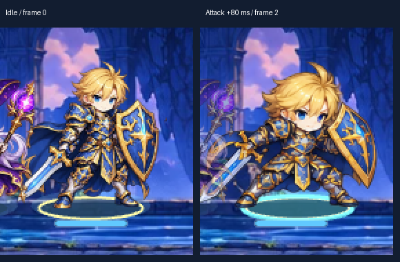
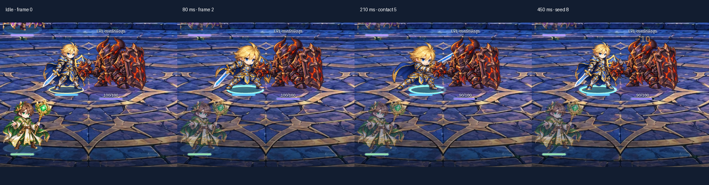

# ตรวจภาพเคลื่อนไหวจริง: อัศวินหัวโตและเด้งเมื่อโจมตี

วันที่ 2026-10-29 (Asia/Bangkok) · source `3d5d1de91c639da6a42635953333a8bd22a3bd7a` บน `feature/fateweave-initial-prototype`

เจ้าของชี้ว่ารอบ audit ก่อนตรวจแต่โค้ด ไม่ได้จับคุณภาพที่มองเห็น: “ตัวอัศวิน จังหวะโจมตีธรรมดา เจอว่าหัวโตกระโดดออกมา” รอบนี้จึงตรวจ texture ที่ใช้จริงและรัน renderer จริง ไม่ถือว่า coverage หรือ CI เป็นการผ่านคุณภาพภาพ

## ผลหลัก — P1: Aegis เปลี่ยนสัดส่วนเมื่อสลับ seed ↔ generated poses

**ยืนยันภาพเสียจริง ไม่ใช่แค่รายการยังไม่ทำ:** ในท่า attack เฟรม `0/1` เป็นเอกิสสัดส่วนเดิม พอเข้า `2–7` หัว/ผมกว้างขึ้น ลำตัวดูเตี้ยและกางออก จากนั้น `8 → 0` คืนร่างเดิมอย่างเห็นได้ชัด จึงรู้สึกว่าหัวโตกระโดดออกมา ขนาดตัวทั้งตัวอาจดูใกล้กันเพราะ pipeline เทียบความสูง silhouette แต่สัดส่วนภายในไม่ตรงกัน



ยืนยันซ้ำจาก **หน้าเกมจริง `/`**: New game → ตั้งชื่อ QA → ข้าม prologue → Start → Lyra attack → Eira attack → Aegis attack ได้อาการเดียวกับ fixture ที่ 80ms ไม่มี pageerror และ save ไม่เปลี่ยนเพิ่มหลัง presentation: [campaign-proof.json](campaign-proof.json), [ก่อนโจมตี](campaign-aegis-idle-390.png), [ระหว่างโจมตี](campaign-aegis-attack-80-390.png) รูป crop ขยายด้านบนใช้เพื่ออ่านสัดส่วน ไม่ได้แก้ pixels ของตัวละคร



- 390×844: ที่ 80ms อ่านได้เป็น frame 2; contact 210ms เป็น frame 5; 450ms กลับ frame 8; 520ms กลับ idle 0
- ค่า sprite displayWidth/displayHeight เท่ากันตลอด 15 samples: `308.3333333333333` และ originY `0.96875` ดู [aegis-capture.json](aegis-capture.json) จึงไม่ใช่คำสั่งขยาย sprite ตอนเข้าเฟรม 2
- เทียบ atlas หลังคืน trim offset ใน logical canvas 512×512 แล้ว พบการเปลี่ยนสัดส่วนใน pixels อยู่แล้ว ไม่ได้เกิดจาก responsive layout หรือ atlas sourceSize สลับผิด: [ภาพเฟรม 0–8](aegis-attack-atlas-comparison.png)
- ที่ 280ms sample ผสมเฟรม 5/6 ด้วย alpha ประมาณ .40/.60 มีเงาซ้อนหัว/ดาบให้เห็นใน [ภาพ runtime](aegis-attack-280-390.png) การ dissolve ระหว่างร่างที่ไม่ตรงกันเพิ่มความรู้สึกภาพกระโดด เป็นผลประกอบของ anatomy mismatch; อย่าแก้ด้วยการเพิ่มเวลาละลายภาพ
- ท่า **bash และ guard** ก็พบการเปลี่ยนสัดส่วนใน screenshot runtime: [bash](aegis-bash-prepare-390.png), [guard](aegis-guard-prepare-390.png) ทั้งสองใช้ generated poses คนละ sequence แต่กลับ seed เดียวกัน
- ทำซ้ำ attack ที่ 320×568 และ 1366×1000 แล้วเห็นปัญหาแบบเดียวกัน: [320](aegis-attack-080-320.png), [PC](aegis-attack-080-1366.png) ไม่ใช่เฉพาะ layout 390px

## ต้นเหตุและไฟล์ที่ Claude ต้องตรวจ

1. `incoming/ART-UNIT-ANIMATION-A2-001/build_assets.py`: เลือก scale เดียวจากความสูง bbox ของ reference row เทียบ seed (`factor=.36`) แล้วสร้าง attack/bash/support จากภาพ generated; endpoint กลับ exact seed (`attack=[idle]+...+[idle]`) การคง scale/sole ไม่ได้ทำให้ขนาดหัว/ช่วงตัวตรงกัน
2. `incoming/ART-UNIT-ANIMATION-A2-001/{aegis-seed.png,aegis-raw.png,validation.json}`: ต้นทาง seed กับ poses มีสัดส่วนต่างกัน ต้องเทียบหัว ใบหน้า ช่วงไหล่ มือ ด้ามดาบ และโล่ก่อน normalize ไม่ใช้เพียง alpha bbox ผ่านเป็น visual pass
3. `public/assets/units/aegis_a2.1d12d3127841.webp` และ `aegis_a2.e88cd1ce5fe0.json`: pixels ที่ runtime โหลดจริงในรอบนี้; frame 0/1/8 อยู่ที่ atlas crop เดียวกัน ขณะที่ 2–7 เป็น generated anatomy
4. `src/game/visuals/unit-frames.ts`: ลำดับ prepare `[1,2,3,4]`, recover `[5,6,7,8]`, blend window สูงสุด 18ms; `unit-frame-view.ts` ใช้สอง Image แสดง crossfade; `unit-animation.ts` มี lunge ของ body ที่ต่อเนื่องตาม weight แยกจากการเปลี่ยน pixels ของหัว อย่าเอาการพุ่งที่ตั้งใจไปปนกับ head pop

**แนวแก้ให้ Claude:** เก็บ approved idle เป็น model sheet แล้วแก้/วาด action frames ให้หัวและสัดส่วนเดียวกับ idle ก่อน pack ใหม่ หาก anatomy ในภาพต้นทางแก้ด้วย normalization ไม่ได้ ให้ทำ brief ส่ง Codex แก้ภาพตามการแบ่งหน้าที่เดิม Claude รับผิดชอบ intake/renderer ไม่ใช้การบีบทั้งตัวทีละเฟรม การขยาย seed ให้หัวโตตามภาพผิด หรือเพิ่ม dissolve เพื่อซ่อนรอยต่อ ห้ามเปลี่ยนกฎต่อสู้/save/ActionId/contact/end เพื่อกลบ defect

## หลักฐานและผลตรวจ

| ตรวจ | ผลและขอบเขต |
| --- | --- |
| หน้าทดสอบ | `/tests/browser/fixtures/unit-a2.html?skill=attack` ใช้ BattleUI/BattleScene/resolver จริง พร้อม encounter fixture เพื่อกำหนดเทิร์นซ้ำได้ ไม่ใช่ mock animation |
| เข้าเกม/ควบคุม | Start → Attack → target-f1 → windup/contact/recover → เทิร์นถัดไป ทำได้ |
| หน้าว่าง/overlay | Canvas และ BattleUI แสดง ไม่มี Vite error overlay ในภาพ |
| Runtime error | ไม่พบ pageerror ใน capture; ไม่อ้างว่า console warning ทุกชนิดเป็นศูนย์ (SwiftShader เป็น software rendering) |
| ผลต่อสู้/เซฟ | deterministic capture: state เท่ากับ expected และ committed save ไม่เปลี่ยนหลัง presentation |
| Existing browser tests | attack/guard/bash windup 3/3 ผ่าน แต่ screenshot ยังมี head pop แสดงว่าเทสต์เดิมไม่ได้ตรวจสัดส่วน |
| Real-clock capture | 1/1 ผ่าน บันทึก CDP จริง 87 frames และ MP4 VFR 88 decoded frames (รวม held tail อีก 1); timestamp error สูงสุดประมาณ 0.00513ms; gap สูงสุดประมาณ .301s ตาม host ดู proof ห้ามใช้เป็นหลักฐาน 60fps |
| ภาพเคลื่อนไหว | **ไม่ผ่าน**: head/body proportion pop ยืนยันจากเฟรมและ renderer |
| Cross viewport | attack reproduced ที่ 320×568, 390×844, 1366×1000 |
| Browser path | ไม่มี Browser runtime/js tool ในเซสชัน ใช้ Playwright + system Chromium ตาม game-playtest workflow; ไม่ใช้แท็บส่วนตัวของเจ้าของ |

คลิปหลัก: [aegis-attack-live-390.mp4](aegis-attack-live-390.mp4) และ [aegis-live-proof.json](aegis-live-proof.json) เก็บ timestamps/click/impact/result ของ capture จริง ไม่ retime หรือ interpolate คลิปนี้เป็นหลักฐานก่อนแก้ ไม่ใช่ผลแก้ที่ผ่านแล้ว

คำสั่งทดสอบที่ใช้:

```sh
PLAYWRIGHT_CHROMIUM_EXECUTABLE=/usr/bin/chromium npx playwright test tests/browser/unit-a2.spec.ts --grep 'A2 (attack|bash|guard): windup' --output /workspace/animation-evidence/test-results --reporter=line
UNIT_A2_CLIPS=1 PLAYWRIGHT_CHROMIUM_EXECUTABLE=/usr/bin/chromium npx playwright test tests/browser/unit-a2-clips.spec.ts --grep 'clip attack-RiftBolt-normal-normal' --output /workspace/animation-evidence/live-capture --reporter=line
```

## ขยายวิธีตรวจให้ทุกตัว ไม่ตีตรา “ผ่าน” จากการมี atlas

ทำ contact-sheet scan ที่สเกลคงที่เทียบ idle/attack/hit/down ของทั้ง 18 loaded identities: [heroes](heroes-atlas-review.png), [foes](foes-atlas-review.png) นี่เป็น sampled artwork review ไม่ใช่การรันทุกท่าในเกมหรือการรับรองว่าอีก 17 ตัวผ่านทั้งหมด อาการที่เจาะจนยืนยัน runtime ในรอบนี้คือ Aegis

Claude ต้องไล่จริงทุกชุดที่เข้าเกมแล้วและทุกชุดที่จะ intake: idle → first generated pose → contact → last generated pose → idle, ท่า hit/block/down/counter, ทิศหน้า/มือ/อาวุธ, ขนาดหัวกับคอ/ไหล่, sole/ตำแหน่ง, shape drift, ghost silhouettes, จุดปล่อย VFX, VFX บังหน้า/HP และขนาดแสดงผลจริง ใส่รายชื่อ clip/time/frame ที่เสียและระดับความสำคัญต่อแถว ไม่เอาจำนวน ActionId ที่ map แล้วมาแทนผล visual QA

## เกณฑ์ตรวจรับการแก้

- Head/face/torso identity เดียวกันก่อนเริ่มท่า ระหว่างฟัน และหลังคืนท่า ไม่มีการยุบ/พองเมื่อข้าม seed boundary
- แยกการหมุนศีรษะ/ย่อตัว/foreshortening ที่ตั้งใจออกจากขนาดหัวโตผิดแบบ ใช้ landmark ของหู/ตา/คาง/คอ/ไหล่เทียบ ไม่บังคับให้ pixel bbox ทุกเฟรมเท่ากัน
- ท่าร่างกายและอาวุธไม่ถูกตัด ไม่ย้ายมือจับ ไม่เกิดดาบ/หน้า/หัวซ้อนระหว่าง blend ที่ขนาดเล่นจริง
- ลอง normal/fast/reduced และ OS reduce, 320/390/PC พร้อม hit/counter/interrupt/skip/reload/resize; ผล resolver และคำสั่งที่ commit คงเดิม
- ส่ง before/after clips โดยคง contact/end เดิม พร้อม source/atlas hashes และภาพ seed↔first/last pose ที่อ่านได้ ทดสอบผ่านอย่างเดียวไม่ปิด finding

รอบนี้เป็น audit และ Handoff ตามคำขอ ไม่แก้ source art/runtime และไม่ประกาศว่าปัญหาถูกแก้แล้ว หลักฐานชุดนี้เสริม source audit ก่อนหน้า ให้ Claude เริ่มแก้ head-pop ที่ผู้ใช้ชี้ก่อนนำ W4–W8 เข้าเกมเพิ่ม
