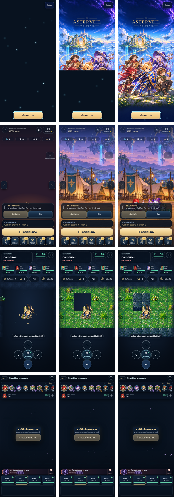

# ภาพว่างก่อนโหลดเสร็จ — ตรวจและวิเคราะห์ (21 พ.ย. 2026)

เจ้าของ: “ไม่ต้องการให้คนเล่นเห็นว่าภาพเป็นช่องว่างก่อนที่จะโหลดภาพ อยากให้เข้าไปแล้วเห็นภาพแสดงเลย ตรวจสอบและวิเคราะห์ทีว่าต้องแก้ไขยังไง” — **วัดและวิเคราะห์เท่านั้น ยังไม่แก้เกม**

## วิธีวัด

- build ล่าสุดของ branch เกม (รวม R1–R10) แบบ Pages, `vite preview`, Chromium 390×844 DPR 3, 4G (9 Mbps/150 ms) + CPU ช้า 4 เท่า
- ทุกการเปลี่ยนหน้าจอ ตรวจทุก 100 ms ว่ามีภาพที่อยู่บนจอแต่ยังโหลดไม่เสร็จไหม (`` ที่ยังไม่ complete และ CSS `background-image` ที่ยังไม่มีไฟล์) พร้อมถ่ายภาพที่ 0.15 / 1 / 3 วินาที — สคริปต์ [`scripts/blank.perf.ts`](scripts/blank.perf.ts), ผลดิบ [`blank-cold.json`](blank-cold.json), [`blank-warm.json`](blank-warm.json)
- **เปิดครั้งแรก** (cache ว่าง) และ **เปิดซ้ำ** (หลังเล่นรอบแรก มี service worker จาก R8)
- Chromium emulation ไม่ใช่มือถือจริง; ไม่ได้วัดบน Pages จริง (container เข้าไม่ได้)

## ผล

| หน้าจอ | เปิดครั้งแรก: ภาพที่ว่างตอนหน้าจอขึ้น | ว่างนานสุด | เปิดซ้ำ (มี SW) |
|---|---|---|---|
| ชื่อเกม | ภาพปาร์ตี้ (`title_party.webp`), โลโก้ | **~3.8 s** (เห็นพื้นมืด แล้วภาพค่อยๆ วาดจากบนลงล่าง) | ไม่มีภาพว่าง |
| ค่าย | ฉากหลัง/หน้า, กองไฟ, NPC 6 ตัว + ซุ้ม, ท่าทางฮีโร่ | **~3.8 s** (ฉากหลังว่าง ~1 s, NPC ~2.3 s, ฮีโร่นั่ง ~3.8 s) | ไม่มีภาพว่าง |
| หน้าต่างในค่าย (ตัวละคร ทีม จ้าง อุปกรณ์ ตีเหล็ก ยา) | — | 0.2–0.3 s (ภาพมาแล้วตอนอยู่ในค่าย) | ไม่มีภาพว่าง |
| แผนที่ | พื้นไทล์ (`tileset`), ของประดับ, หมอก, ตัวบอกทาง | **~3.9 s** (ตัวละครยืนบนพื้นมืด แล้วหญ้าค่อยๆ เติม) | ไม่มีภาพว่าง |
| ศึก (เปิดเซฟที่ค้างในศึกตรงๆ) | ภาพพื้นหลังศึก | **~7.6 s**; ปุ่ม “เริ่มต่อสู้” กดได้ที่ **19.7 s** (สนามว่าง + “กำลังเตรียมสนาม…”) | ภาพครบทันที แต่ปุ่มเริ่มยังรอ **11.6 s** |

## สาเหตุ

1. **ภาพของแต่ละหน้าจอเพิ่งเริ่มโหลดตอนเข้าหน้าจอนั้น** — ภาพเป็น CSS background / `` ที่ JavaScript สร้างตอน render หน้าจอ เบราว์เซอร์จึงรู้จักไฟล์เมื่อหน้าจอขึ้นแล้ว: หน้าชื่อเกมรอ JS (~0.7 MB gzip) โหลดและรันก่อน แล้วจึงเริ่มโหลดภาพ; ค่ายเริ่มโหลด ~12 ไฟล์ (~2 MB) ตอนกด “เข้าค่าย”; แผนที่เริ่มโหลดไทล์ (0.91 MB) + ของประดับ (0.74 MB) ตอนเข้าแผนที่
2. **ไม่มีอะไรแทนระหว่างรอ** — ระหว่างโหลด เห็นแค่สีพื้น และ webp ใหญ่ถูกวาดทีละส่วนจากบนลงล่าง (ภาพปาร์ตี้หน้าชื่อเกม)
3. **หน้าจอสลับทันทีโดยไม่รอภาพ** — `GameShell.show()` สลับ view ทันทีที่ state พร้อม ไม่ดูว่าภาพหลักถอดรหัสแล้วหรือยัง
4. **ศึก**: ภาพพื้นหลังศึก (0.48 MB) และ atlas ของศึกโหลดตอนเปิดศึก (R1 prefetch บนแผนที่ช่วยเฉพาะกรณีเดินเข้าศึก ไม่ช่วยกรณีเปิดเกมแล้ว “เดินทางต่อ” เข้าศึกที่ค้างอยู่); แม้มีใน cache แล้ว การถอดรหัส + อัปโหลด texture ใหญ่ (เช่น healing 3504×1480) ยังใช้หลายวินาทีที่ CPU 4× + WebGL ซอฟต์แวร์ — ต้องวัดบนมือถือจริงว่าจริงๆ นานแค่ไหน
5. R8 (service worker) แก้การเปิดซ้ำแล้ว — ปัญหาที่เหลือคือ **การเปิดครั้งแรก** และ **ครั้งแรกหลัง deploy ที่เปลี่ยนไฟล์ภาพนั้น**

## แนวทางแก้ (เรียงตามผล/ความคุ้ม)

| # | แก้อะไร | ผลที่คาด | ความเสี่ยง | ขนาดงาน |
|---|---|---|---|---|
| B1 | **รอภาพหลักก่อนสลับหน้าจอ**: ตัวช่วย `ready(urls)` = โหลด + `img.decode()`; `show(view)` / เข้าค่าย / เข้าแผนที่ / เข้าศึก รอภาพหลักของหน้าจอนั้น (ฉากหลัง, ไทล์, NPC ในจอ, ภาพศึก) ไม่เกินเพดาน (ร่าง 1.5–2 s) โดยหน้าจอเดิมค้างไว้พร้อมตัวบอกโหลดเล็กๆ บนปุ่มที่กด แล้วค่อย fade เข้า | หน้าจอใหม่ขึ้นมาพร้อมภาพครบ ไม่เห็นช่องว่าง (ถ้าเน็ตช้ากว่าเพดาน จะเหลือแค่ส่วนที่ยังไม่มา) | กลาง: กดแล้วต้องมี feedback ทันที (ปุ่มกด/วงหมุน) ไม่งั้นรู้สึกว่าเกมไม่ตอบ; ต้องไม่ล็อกถาวรถ้าภาพพัง | กลาง |
| B2 | **โหลดภาพของหน้าจอถัดไปล่วงหน้าระหว่างที่ผู้เล่นยังอยู่หน้าจอปัจจุบัน**: หน้าชื่อเกม → ภาพค่าย (และภาพแผนที่/ศึกถ้าเซฟค้างอยู่บนแผนที่/ในศึก — ใช้ encounter ในเซฟ); ค่าย → ไทล์/ของประดับ/หมอกของแผนที่ที่จะไป; แผนที่ → ภาพพื้นหลังศึก + atlas (มีแล้วจาก R1, เพิ่มภาพพื้นหลังศึก) — โหลดตอนว่าง (`requestIdleCallback`) ลำดับต่ำกว่าภาพบนจอ | ส่วนใหญ่ภาพมาถึงก่อนผู้เล่นกด ทำให้ B1 ไม่ต้องรอจริง | ต่ำ: ใช้เน็ตมากขึ้นเล็กน้อยถ้าผู้เล่นไม่ไปหน้านั้น | เล็ก–กลาง |
| B3 | **ภาพหน้าชื่อเกมเริ่มโหลดพร้อม JS**: `<link rel="preload" as="image" fetchpriority="high">` ใน `index.html` สำหรับภาพปาร์ตี้ + ฉาก + โลโก้ และพื้นหลังหน้าชื่อเกม/สีไล่ระดับใน HTML ก่อน JS พร้อม | ภาพหน้าชื่อเกมมาเร็วขึ้น ~1 s บน 4G (ไม่ต้องรอ JS) | ต่ำ (ต้องใส่ path ตาม base ของ Pages) | เล็ก |
| B4 | **ภาพเบลอขนาดจิ๋วแทนช่องว่าง (LQIP)**: build สร้างภาพย่อ ~24–32 px ของภาพฉากใหญ่ (ชื่อเกม ค่าย พื้นหลังศึก ฉากเล่าเรื่อง) ฝังเป็น data URI (~1–2 KB ต่อภาพ) แสดงทันทีแล้ว crossfade เป็นภาพจริงเมื่อ decode เสร็จ | แม้เน็ตช้าที่สุด ก็ไม่เห็นพื้นว่าง/ภาพวาดครึ่งจอ — เห็นภาพเบลอสีถูกต้องแล้วชัดขึ้น | ต่ำ; ต้องให้เจ้าของดูลุค | กลาง |
| B5 | **ไฟล์เล็กลง**: ไทล์แผนที่ (0.91 MB) และของประดับ (0.74 MB) เป็น lossless — ทำ lossy คุณภาพสูง/แบ่งตามแผนที่ที่ใช้; ภาพปาร์ตี้หน้าชื่อเกม (0.44 MB) แยก/ลดขนาด | โหลดเร็วขึ้น 2–4 เท่าสำหรับไฟล์เหล่านี้ | ต้องให้เจ้าของดูภาพ (ขอบไทล์/ศิลป์) | เล็ก–กลาง |
| B6 | **ศึกจากเซฟที่ค้าง**: เริ่มโหลด atlas + ภาพศึกของ encounter ในเซฟตั้งแต่หน้าชื่อเกม (ข้อมูลอยู่ในเซฟแล้ว); วัดบนมือถือจริงว่าการ decode/อัป texture นานแค่ไหน แล้วพิจารณาแปลง atlas เป็นไฟล์เล็กลงหรือ decode ทีละไฟล์ระหว่างรอ | ปุ่มเริ่มต่อสู้พร้อมเกือบทันทีเมื่อเปิดเกมมาเล่นต่อในศึก | ต่ำ–กลาง | เล็ก (โหลดล่วงหน้า) + ต้องวัด (decode) |

แนะนำ: **B2 + B3 + B1** ก่อน (แก้อาการที่เจ้าของเห็นตรงที่สุด ไม่เปลี่ยนภาพ) → B6 → B4/B5 (ต้องให้เจ้าของดูภาพ)

ผลที่คาดเมื่อทำ B1–B3: เปิดครั้งแรกบน 4G — หน้าชื่อเกมเห็นภาพครบภายใน ~2–3 s ก่อนปุ่มขึ้น/หรือขึ้นพร้อมกัน; ค่าย/แผนที่ขึ้นมาพร้อมภาพ (โหลดไว้แล้วระหว่างหน้าก่อน หรือรอไม่เกินเพดานพร้อมตัวบอกโหลด); เปิดซ้ำยังเหมือนตอนนี้ (ทันที จาก SW)
