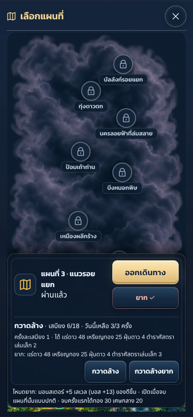

# P05-05 — ต้นแบบกวาดล้าง (เซฟ v62)

15 พฤศจิกายน 2026 · Opus · ตาม [World Boss/กวาดล้าง §4](../../design/WORLD_BOSS_SWEEP_TH.md) และ OD-35 · ก่อนเริ่มบันทึกคำตอบเจ้าของ “ทำตามที่แนะนำ” เป็น OD-39–41 ([OWNER_DECISIONS_TH.md](../../design/OWNER_DECISIONS_TH.md)) โดยไม่แก้โค้ด/ตัวเลขจากสามข้อนั้น

## สิ่งที่สร้าง (ต้นแบบออฟไลน์ ตัวเลขเป็นร่าง)

| ส่วน | รายละเอียด |
|---|---|
| ปลดล็อก | เฉพาะแมพที่ผ่านแล้ว (`cleared`); แถวโหมดยากต้องผ่านโหมดยากของแมพนั้น (`clearedHard`) · ไม่มีคำสั่งกวาดล้างสิ่งอื่นนอกจากแมพ (ไม่มี World Boss) |
| ค่าใช้จ่าย | เสบียง 1 ต่อครั้ง · ได้ 6 ต่อวัน สะสมได้ 18 (เริ่มวันแรก 6) · ลงเล่นเองไม่ใช้เสบียง |
| โควตา | 3 ครั้งต่อแมพต่อวัน **นับปกติและยากรวมกัน** (สลับโหมดไม่เพิ่มสิทธิ์) |
| รางวัลซ้ำ | ตารางคงที่ต่อแมพ (ไม่สุ่ม) แสดงก่อนกด ใช้ทรัพยากรเดิม: แร่ดาว ทอง ฝุ่นดาว ตำราเล่มเล็ก (สายของทีมที่ลงสนาม) |
| ไม่ให้/ไม่แตะ | EXP ค่าย, อุปกรณ์, เศษกลาง, แกนรอยแยก, รางวัลครั้งแรก/หีบ/ความลับ/ปริศนา/อีเวนต์, เควสต์ค่ายและเควสต์เรื่อง, `choices`/`storyQuests`, ตลาด/ป้ายจ้าง/จำนวนเที่ยว |
| atomic | `core/world/sweep.ts` `sweep()` คืนโปรไฟล์ใหม่ทั้งก้อน (เสบียง + โควตา + รางวัล) หรือคืนของเดิมพร้อมเหตุผล; คลังเต็ม = ปฏิเสธ ไม่เสียเสบียง |
| retry | คำสั่ง `sweep` พก `serial` (= จำนวนกวาดล้างที่เครื่องเห็น) กดซ้ำ/ส่งซ้ำด้วยเลขเดิมถูกปฏิเสธ `stale` ไม่จ่ายซ้ำ; ผ่าน command envelope คำขอ `requestId` เดิมได้คำตอบเดิม |
| วัน | เลขวันปฏิทินของเครื่อง ส่งมากับคำสั่ง; นาฬิกาถอยหลังไม่ได้เสบียง/ไม่รีเซ็ตโควตา · นาฬิกาเดินหน้าปลอมยังทำได้ (ออฟไลน์เชื่อไม่ได้) → เวลา server + ledger เป็นงาน P09 |
| เซฟ | v62: `Profile.sweep { day, supply, used, count }` (ไม่บังคับ; v61 โหลดได้เหมือนเดิม) ตรวจเพดานเสบียง/โควตา/แมพที่ผ่านแล้ว |
| UI | หน้าเลือกแผนที่: แถว “กวาดล้าง” ใต้การ์ดแมพที่ผ่านแล้ว ปุ่ม ≥44px บอกเหตุผลเมื่อกดไม่ได้ |

## ตารางรางวัล (ร่าง)

วัดด้วย `SWEEP_OUT=<ไฟล์> npx vitest run tests/probe/p0505-sweep.test.ts` (8 ค่าย × rush/explorer, casual): เที่ยวสำเร็จแบบ rush นำกลับเฉลี่ย แร่/ทอง 46/20 (แมพ 1), 45/21 + ตำรา 5 (แมพ 2), 144/75 + ฝุ่น 12 + ตำรา 11 (แมพ 3); explorer แมพ 3 ได้ 488/273 + ตำรา 24 · ตั้งกวาดล้างไว้ราวหนึ่งในสามของเที่ยว rush และไม่ให้ของที่การลงเล่นจริงให้

| แมพ | ปกติ | ยาก (OD-41: แร่/ทองเท่าเดิม) |
|---|---|---|
| 1 ซากชายแดน | แร่ 15 ทอง 7 | เท่ากัน |
| 2 เส้นทางป่าทึบ | แร่ 15 ทอง 7 ตำราเล็ก 1 | ตำราเล็ก 2 |
| 3 แนวรอยแยก | แร่ 48 ทอง 25 ฝุ่น 4 ตำราเล็ก 2 | ตำราเล็ก 3 |

ใช้เสบียงครบ 6 ต่อวันได้มากสุด แร่ 189 ทอง 96 ฝุ่น 12 ตำราเล็ก 9 (ยาก 15) ≈ เที่ยว rush ของแมพ 3 หนึ่งเที่ยวรวมแมพ 2 หนึ่งเที่ยว แต่ไม่มี EXP/อุปกรณ์/เศษ/แกน — การลงเล่นเองยังคุ้มกว่า และสะสม 18 รองรับคนเล่น 3–5 ครั้ง/สัปดาห์ (OD-06)

## ผลตรวจ

- `tests/sweep-p05.test.ts` 12 ข้อ: ปลดล็อก, จ่ายครั้งเดียวไม่แตะอย่างอื่น, โควตารวมปกติ/ยาก, เสบียงข้ามวัน/เพดาน/นาฬิกาถอยหลัง, คลังเต็ม, retry (กฎ + envelope), เซฟ v62 และปฏิเสธสมุดผิดกฎ
- `tests/browser/sweep-p05.spec.ts` (Chromium 390px): กวาดล้าง 3 ครั้ง ปุ่มปิดเมื่อครบ บันทึกแล้วโหลดใหม่ยังอยู่; สเปกหน้าแผนที่เดิมที่รันในเครื่อง 33 ข้อผ่าน
- unit ทั้งชุด, typecheck, lint, build ผ่าน; `npm run sim` ผ่าน (กวาดล้างไม่อยู่ในเส้นทาง sim — ไม่มีประตูสมดุลเปลี่ยน)
- ยังไม่ได้ทดสอบบนอุปกรณ์จริง (Safari/iPhone/Android) และยังไม่ได้ทดสอบกับ dev API ที่ deploy จริง

## สมมติฐานและข้อเปิด (ให้เจ้าของทบทวน)

1. โควตา 3/แมพ/วัน **รวมปกติ+ยาก** และราคาเสบียงเท่ากัน — แถวยากจึงดีกว่าเสมอเมื่อผ่านโหมดยากแล้ว (รางวัลของการเก่งขึ้น แนวเดียวกับ OD-35)
2. กวาดล้างไม่ให้ EXP ค่ายและอุปกรณ์ — ถ้าต้องการให้ ต้องกำหนดค่าเฉพาะและตรวจกับเพดาน Lv ค่าย P06
3. ตัวเลขตาราง/เสบียงเป็นร่าง รอทบทวนพร้อมงบฟาร์ม P04-06 และกระดาน P05-06
4. ออนไลน์: server ยังรับ `day` จากเครื่อง — ต้องเปลี่ยนเป็นเวลา server + ledger ใน P09 ก่อนเปิดทดสอบภายนอก (OD-13)
