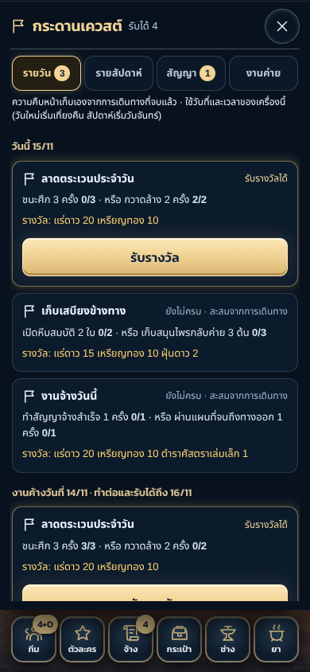

# P05-06 — ต้นแบบกระดานเควสต์ (เซฟ v63)

15 พฤศจิกายน 2026 · Opus · ตาม [แชต/ตลาด/กระดาน §5](../../design/CHAT_MARKET_QUEST_BOARD_TH.md), [P05-01 สัญญาจ้าง 6 งาน](../../design/p05/ACTIVITY_INVENTORY_TH.md) และ OD-37 · เจ้าของยังไม่ได้ตอบสมมติฐานกวาดล้าง P05-05 (PR #254 ไม่มีความเห็น) จึงคงกวาดล้างตามเดิม

## สิ่งที่สร้าง (ต้นแบบออฟไลน์ ตัวเลขเป็นร่าง)

| ส่วน | รายละเอียด |
|---|---|
| กระดานเดียว | ปุ่ม “กระดานเควสต์” เดิมในค่าย มีสี่แท็บ: **รายวัน · รายสัปดาห์ · สัญญา · งานค่าย** (งานค่าย = เควสต์ NPC หกงานเดิม รับครั้งเดียวเหมือนเดิม) ตัวเลขรางวัลรวมทุกแท็บอยู่ที่ป้ายปุ่ม |
| เปิดเมื่อ | เหมือนเควสต์ค่าย (หลังผ่านแมพ 1, `quests`) · คำสั่งรับรางวัลก่อนเปิดถูกปฏิเสธ `locked` |
| เก็บความคืบหน้าเอง | ไม่ต้องรับงานก่อนออกเดินทาง: `depart` ประทับวันของเครื่อง (`run.day`) แล้วตอนจบเที่ยวนับให้วันนั้น (`settleBoard`) · การกวาดล้างนับ **เฉพาะ** งานที่เขียนว่า “กวาดล้าง” (ไม่นับเป็นศึก/หีบ/สัญญา) · เที่ยวที่ออกก่อน v63 ไม่นับ |
| งานทางเลือก | แต่ละงานมีทางที่สองได้ (`alt`) เช่น ชนะศึก 3 **หรือ** กวาดล้าง 2 — ไม่บังคับตัวกาชา/อาชีพ/การซื้อ |
| catch-up | วันที่พลาด (นับจากวันที่กระดานเห็นล่าสุด) เปิดเป็น “งานค้าง” สูงสุด 2 วัน + วันนี้ · การล็อกอินอย่างเดียวได้แค่ชุดว่าง ต้องเล่นจึงคืบ · ความคืบหน้าเข้าวันนี้ก่อน ส่วนที่เกินช่วยวันค้างเก่าสุด |
| รับครั้งเดียว/ช่วงรับ | ทุกงานจ่ายครั้งเดียวต่อช่วง (วัน/สัปดาห์) · รายวันรับได้ 3 วัน (วันนั้น + 2 วัน) · รายสัปดาห์และสัญญาของสัปดาห์ที่แล้วรับได้จนจบสัปดาห์นี้ (ไม่คืบเพิ่ม) · รับซ้ำ = `claimed` ไม่จ่ายซ้ำ · คลังเต็ม = ปฏิเสธไม่เสียอะไร |
| สัญญาจ้าง 6 | เบาเท้า/นักสำรวจ/ไม่นองเลือด/ทีมเล็ก/ไม่ล้มสักคน/ส่งสมุนไพร (`job-*`) ตรวจเองเมื่อ **ผ่านแมพ** เท่านั้น · OD-37: ไม่มีค่าธรรมเนียม ไม่มีโทษ ถอน/ล้มไม่เสียอะไร · สัญญาละครั้งต่อสัปดาห์ จ่ายรางวัลของแมพที่ยากที่สุดที่ทำได้ในสัปดาห์นั้น |
| วัน/เวลา | วันปฏิทินของเครื่อง (เที่ยงคืนท้องถิ่น) สัปดาห์เริ่มวันจันทร์ แสดงบนจอ · นาฬิกาถอยไม่ได้อะไร · นาฬิกาเดินหน้าปลอมยังได้ชุดใหม่ (ออฟไลน์เชื่อไม่ได้) → เวลา server + ledger + periodID เป็นงาน P09 |
| เซฟ | v63: `Profile.board { day, days, weeks }`, `run.day` (ไม่บังคับ; v62 โหลดเหมือนเดิม) · ตรวจวัน/สัปดาห์ที่เปิดได้, ชนิดตัวนับ, งานที่รับแล้วต้องทำครบจริง, สัญญาต้องมีแมพ · กวาดล้าง ธงเรื่อง ตัวนับ เควสต์ทางเลือกเดิมไม่เปลี่ยน |

## งานและรางวัล (ร่าง)

| ช่วง | งาน | เป้า (หรือ) | รางวัล |
|---|---|---|---|
| รายวัน | ลาดตระเวนประจำวัน | ชนะศึก 3 · หรือ กวาดล้าง 2 | แร่ 20 ทอง 10 |
| รายวัน | เก็บเสบียงข้างทาง | เปิดหีบ 2 · หรือ สมุนไพร 3 | แร่ 15 ทอง 10 ฝุ่น 2 |
| รายวัน | งานจ้างวันนี้ | สัญญาสำเร็จ 1 · หรือ ผ่านแมพ 1 | แร่ 20 ทอง 10 ตำราเล็ก 1 |
| สัปดาห์ | เที่ยวกลับค่าย | ผ่านแมพ 4 · หรือ กวาดล้าง 9 | แร่ 60 ทอง 30 |
| สัปดาห์ | ผลงานในสนามรบ | ชนะศึก 15 | แร่ 50 ทอง 30 ตำราเล็ก 2 |
| สัปดาห์ | ล่าหัวหน้า | ปราบหัวหน้า 3 | แร่ 40 ทอง 20 ฝุ่น 6 |
| สัปดาห์ | เรื่องเล่าระหว่างทาง | เหตุการณ์ 4 · หรือ ไขกลไก/ทางลับ 3 | แร่ 40 ทอง 25 ฝุ่น 4 |
| สัปดาห์ | สัญญาจ้างของสัปดาห์ | สัญญาสำเร็จ 3 | แร่ 60 ทอง 30 ตำราเล็ก 3 |

สัญญาจ้างต่อแมพ: ซากชายแดน แร่ 15 ทอง 8 (เบาเท้า ≤18 ก้าว) · ป่าทึบ แร่ 15 ทอง 8 ตำราเล็ก 1 (≤30) · แนวรอยแยก แร่ 40 ทอง 20 ฝุ่น 2 ตำราเล็ก 1 (≤90) — ใกล้เคียงการกวาดล้างหนึ่งครั้งของแมพนั้น · ไม่มีเศษกลาง (OD-17: รอ ledger) ไม่มีสกุลเงินใหม่

## จำลอง (`BOARD_OUT=<ไฟล์> npx vitest run tests/probe/p0506-board.test.ts`, 8 ค่าย × rush/explorer, casual)

| แมพ | rush ก้าว | explorer ก้าว | สัญญาที่ sim ทำได้เอง |
|---|---|---|---|
| ซากชายแดน | 10 | 34 | rush: ทีมเล็ก 8/8, ไม่ล้ม 2/8 · explorer: นักสำรวจ/ไม่นองเลือด/ทีมเล็ก 8/8, ไม่ล้ม 5/8 |
| ป่าทึบ | 11–13 | 87–105 | rush: ไม่ล้ม 4/8 · explorer: นักสำรวจ/ไม่นองเลือด/สมุนไพร 8/8 |
| แนวรอยแยก | 53–65 | 197 | rush: ไม่ล้ม 21/24 · explorer: นักสำรวจ/ไม่ล้ม/สมุนไพร 24/24 |

- เบาเท้าตั้ง 18/30/90 ก้าว: rush ผ่านทุกเที่ยว explorer ไม่ผ่าน → เป็นทางเลือกจริง (เร็ว vs สำรวจ)
- ไม่นองเลือดที่แนวรอยแยก: sim สู้โจรเสมอจึงไม่เคยทำได้ ทางย่อง/ช่วย/อธิษฐาน/เดินผ่านเปิดให้ผู้เล่น (เทสต์ยืนยันเงื่อนไข) — ยังไม่ได้วัดว่าคนเล่นจริงทำได้บ่อยแค่ไหน
- ต่อหนึ่งเที่ยว rush แมพ 3: ชนะ ~13 หัวหน้า 2 เหตุการณ์ 1 → รายสัปดาห์ “ชนะ 15/หัวหน้า 3” ครบใน 2 เที่ยว; “ผ่านแมพ 4” ครบใน 3–5 ครั้งเล่น/สัปดาห์ (OD-06) ไม่ต้องเข้าทุกวัน
- งบสูงสุดต่อสัปดาห์ (ทำรายวัน 5 วัน + รายสัปดาห์ครบ + สัญญา 6 ที่แมพ 3): แร่ ≈ 765 ทอง ≈ 405 ≈ เที่ยว explorer แมพ 3 ราว 1.6 เที่ยว หรือราว +25% ของการเล่นสัปดาห์หนึ่ง (~10 เที่ยว) — ต้องรวมกับงบฟาร์ม P04-06 ก่อนใช้จริง
- `npm run sim` 29/29 ผ่าน รายงานไม่เปลี่ยน (เที่ยว sim ไม่มีวัน จึงไม่ผ่านกระดาน)

## ผลตรวจ

- `tests/board-p05.test.ts` 12 ข้อ: เนื้อหา, นับเองจากการจบเที่ยว/ไม่นับเที่ยวไม่มีวัน, กวาดล้างนับเฉพาะงานกวาดล้าง, catch-up/ช่วงรับ/นาฬิกาถอย, สัปดาห์ใหม่, สัญญา (ผ่าน/ถอน/ล้ม, ไม่นองเลือด, ครั้งเดียวต่อสัปดาห์จ่ายแมพดีสุด), รับครั้งเดียว all-or-nothing, คำสั่ง+`locked`, เซฟ v63 และปฏิเสธสมุดผิดกฎ; `game-command` เทียบคำสั่งกับการเรียกกฎตรง
- `tests/browser/quest-board-p05.spec.ts` (Chromium 390px): กวาดล้าง 2 ครั้ง → ลาดตระเวนวันนี้พร้อมรับ, งานค้างเมื่อวานยังรับได้, แท็บ ≥44px, รับรายวันและสัญญาแมพ 3 แล้วบันทึก, โหลดใหม่ยังอยู่; สเปกกระดานเควสต์เดิม/กวาดล้างผ่าน (เปิดแท็บ “งานค่าย”)
- unit ทั้งชุด, typecheck, lint, build ผ่าน · ยังไม่ได้ทดสอบบนอุปกรณ์จริงและกับ dev API ที่ deploy

## สมมติฐานและข้อเปิด (ให้เจ้าของทบทวน)

1. สัญญาจ้าง **ตรวจเองทุกเที่ยว** ไม่ต้องกดรับก่อนออกเดินทาง (ตรงกับ “เก็บ progress อัตโนมัติ” และ OD-37 ไม่มีโทษ) — ถ้าต้องการขั้นรับสัญญาที่ค่ายต้องเพิ่ม UI และสถานะ
2. งานรายวัน/รายสัปดาห์เป็นชุดคงที่ (ไม่สุ่มหมุนเวียน) ในต้นแบบ
3. catch-up สูงสุด 2 วันย้อนหลัง, รายสัปดาห์ก่อนหน้ารับได้อีก 1 สัปดาห์, ส่วนเกินเข้าวันค้างเก่าสุด — ร่าง
4. ตัวเลขรางวัลเป็นร่าง รอรวมงบฟาร์ม P04-06; ไม่มีเศษกลางจนมี ledger (OD-17)
5. ออนไลน์: server ยังรับ `day` จากเครื่อง — ต้องเปลี่ยนเป็นเวลา server + periodID/receipt ใน P09 ก่อนเปิดทดสอบภายนอก (OD-13)
