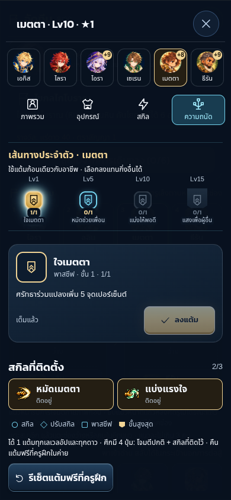
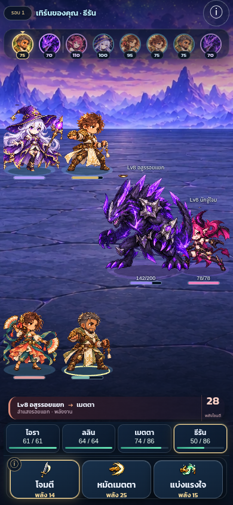

# C12 Batch 1 — Saint / Dancer

Implementation branch `codex/roster-30-2`, base `5a613a5`. Four new members (Metta/Thiran, Lalin/Wila), 12 classes / 14 characters, save v43. The paired campaign release gate now passes all twenty cells. Final CI and publication status are recorded below when complete.

## Behavior

Saint converts HP actually removed by its own command into healing for wounded living allies, without self-healing or multiplying overkill/retaliation. Shared trees each have 16 nodes; every new character has a paid four-tier personal branch using the existing point budget. Dancer reduces absolute-round cooldowns of equipped eligible skills, excludes all Dancer cooldown skills to prevent loops, never changes turn order and stores explicit skill/recipient choices in replay commands.

Save v42 preserves original characters, investments, active runs and commands. Its existing hiring board uses a legacy-pool snapshot until refresh/return. All 24 encounter definitions increment version; old ten-character rule behavior is unchanged. New characters are not injected into old saves or the free starter draft.

## Art and UI

Four production units and portraits, twelve icons, four weapons; original decoded atlas cells preserved. Sources/provenance/rebuild: `incoming/ROSTER-30-BATCH-1/`. Existing 390px portrait frame and field remain; native modal selectors commit only after the final choice, and cancelling changes no save. Root inspected both screenshots below. Chromium touch emulation / SwiftShader, not physical iOS verification. Browser connector tools unavailable; repository-authorized Playwright used with installed `/usr/bin/chromium`.

## Validation evidence

- typecheck, lint, production and Pages builds pass (existing chunk advisory).
- New content/battle tests: 30 pass; focused world/save 76 and additional migration regressions 94 pass.
- Full local unit run: 837 pass, one historical metrics test assumption failed; fixed to inspect every catalog character and tree skill, focused metrics 4/4 pass. Final CI remains pending.
- Browser: two painted-icon regressions pass; both C12 cases pass after correcting the camp-prefixed test selector. Covers explicit talent spend, cancellation without a save change, Duet selection saved once, true Saint heal events and reload equality.
- Full baseline sim 26/26; full expanded-catalog sim 27/27; 42 character/map cells each clear 12/12 traversal seeds. Boss equipment matrix expands to 16,464 fights and passes. No existing battle balance number changed.
- Sixteen new legal tree examples and paired personal-branch removal are in `docs/validation/balance-sim/TREES.md`. Points are not reallocated for the ablation. Lv15 tier-four nodes are outside current Lv10 map sampling; unit tests cover them. Best build means best among tested legal priorities, not exhaustive optimization. Some personal branches have zero/negative marginal HP in these samples, rather than a universal advantage.

## Campaign release gate — twenty cells pass

The original scripted lobby buys every offered character even when it will never deploy that member. Expanding the catalog changes those purchases, weapons and duplicate availability. The first paired report has regressions in six of twenty first-normal/hard cells, so a passing generic sim suite is insufficient to release this batch. Original reports are preserved as `campaign-original-policy-before.md` and `campaign-original-policy-after.md`.

A paired selective-purchase diagnostic (same policy on both base and new code) still found five regressions when the board shared one expanded pool. Fixing only the simulated player was insufficient. The implemented recruitment fix keeps the original three offers and their duplicate odds unchanged, and appends one independently sampled optional featured recruit. It adds no currency, price or forced purchase. Old v42 open boards remain exactly three offers until their next refresh/return; v43 saves validate a purchased fourth-slot index.

The fixed-team campaign policy now buys only deployed-member duplicates; the same policy was applied to base `5a613a5` without changing any of its game code. Baseline: `campaign-selective-before.md`, including its policy change in `tests/fixtures/c12-campaign-before.json`. Final actual new game: `CAMPAIGN.md`. The live full-sim twenty-cell assertion passes; each cell is identical to its immediate-base counterpart (12 companies × rush/explorer × advisor/casual, first normal clears and two hard runs). The pre-fix expanded-pool diagnostic is retained in `campaign-selective-expanded-pool.md`. Broader roster acquisition remains a player investment choice; this fixed-team benchmark does not claim that buying every idle recruit has no resource cost.

The original-policy C11 report remains unchanged at `docs/validation/balance-sim/CAMPAIGN.md`, with its historical C11 acceptance check. C12 writes its current campaign report separately so that different purchasing policies are never compared as though identical. This is not a replacement of the old numerical thresholds: C12 has an additional live twenty-cell gate against the immediate base using the identical new policy.
