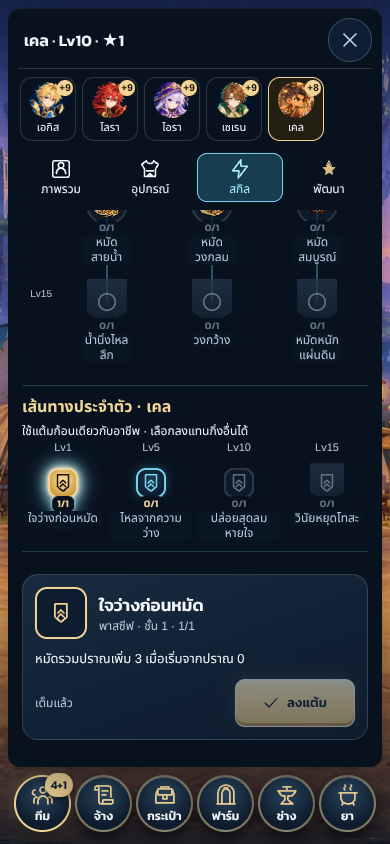

# P03 — เคล/วินน์/แอสทริด (OD-14 อาชีพละ 1 ตัว)

แบ่ง PR ตามกลไก: PR1 เคล (นักมวย · ปราณ) + นำเข้าภาพนิ่งสามตัว → PR2 วินน์ (นักสาป) → PR3 แอสทริด (โหราจารย์) สเปก `docs/design/ROSTER_30_TH.md` §3–5 ตัวเลขทั้งหมดเป็นร่าง

## PR1 เคล (นักมวย) — save v47

กฎ (`core/battle/engine.ts`, ส่วน "P03 Martial"):
- ปราณ 0–3 เริ่มศึกที่ 0 เก็บใน `HeroState.chi` (เฉพาะในศึก); คำสั่งของเคลที่ทำเลือดศัตรูลดจริงอย่างน้อยหนึ่งตัว +1 หลังจบคำสั่ง (หลายเป้าก็ +1) ท่าที่จ่ายปราณ (ปล่อยปราณ/หมัดวงกลม/หมัดสมบูรณ์) ไม่สร้างกลับ; การสวนกลับ/อุปกรณ์ไม่สร้างปราณ ไม่แตะ SPD/คิว/จำนวนเทิร์น
- ปราณไม่พอ → `actionReason` = `Not enough chi.` (ไทย: ปราณไม่พอ) ใช้ทั้ง UI, preview และ commit
- ปล่อยปราณ = (10 + 8×แต้ม) โตตาม Attack/เลเวลสกิล แล้วบวกโหนดแบบ flat (`releasePower`) ปุ่มในศึกแสดงพลังจริงตามปราณขณะนั้น
- ต้นไม้ 16 โหนด + กิ่งประจำตัว 4 ชั้นตามตาราง; การตีความที่ Claude ตัดสินใจ: **kael p4** “เก็บปราณไม่ได้จนเทิร์นตนถัดไป” = คำสั่งถัดไปของเคลหลังหมัดสมบูรณ์ไม่สะสมปราณ (`chiLocked`) เพราะปราณสร้างจากคำสั่งตนเองเท่านั้น ตีความตามตัวอักษรจะไม่มีผลเสียเลย
- การรับตัว: ช่อง featured ของบอร์ดจ้าง (เหมือนคอริน/เซรีส) ไม่อยู่ในดราฟต์เริ่มเกมหรือเรื่องเล่า; สามช่องเดิมและอัตราตัวซ้ำไม่เปลี่ยน

เซฟ v47: โปรไฟล์เก็บรายชื่อช่อง featured ของบอร์ดที่เปิดอยู่ (`boardFeatured`) เซฟ v46 ได้รายชื่อเดิม `[metta, lalin]` จนกว่าจะกลับค่าย/รีเฟรช บอร์ดและดัชนีที่จ่ายแล้วจึงไม่เปลี่ยนตอนโหลด ตัวที่เพิ่มภายหลัง (วินน์/แอสทริด) ไม่ต้องขึ้นเวอร์ชันเซฟอีกเพราะ v47 เก็บรายชื่อไว้แล้ว; ไม่ bump encounter version เพราะกฎของตัวเดิมไม่เปลี่ยน (ทดสอบ replay คำสั่งเก่าผ่านทั้งชุด)

ภาพ (Claude ตัดสินใจตามที่เจ้าของมอบหมาย 2026-11-04 ไม่ใช่การอนุมัติของเจ้าของ):
- `incoming/P03-NEW-CLASSES/package.py` ต่อเซลล์ 10–12 ของ `units_mercs`/`portraits_mercs` (เคลจาก NEW-003, วินน์/แอสทริดจาก NEW-002 ที่เจ้าของอนุมัติ 2026-10-31), ไอคอน 18 อันเข้า `skill_icons` (ย่อด้วย routine C1 เดิม), อาวุธ 3 ชิ้นเข้าเซลล์ว่างของ `gear_items`; เซลล์เดิมทุกช่องตรวจว่าพิกเซลเท่าเดิม (lossless) ผลตรวจใน `incoming/P03-NEW-CLASSES/validation.json`
- เคลใช้ภาพนิ่ง + procedural จนกว่าอนิเมชัน CODEX-A12 จะมา (`STILL_ONLY` ในตาราง coverage); VFX หมัดยืมภาพหมัดของนักบุญรบ วางบนศัตรูที่โดนจริงเท่านั้น

 

ภาพจาก Playwright Chromium (SwiftShader, touch emulation 390px) ไม่ใช่อุปกรณ์จริง

### ผลตรวจ PR1

- `npm run typecheck`, `npm run lint`, `npm test` (1559 ผ่าน), `npm run build`
- เทสต์ใหม่ `tests/roster-p03-kael.test.ts` 20 ข้อ: เพดาน/ไม่พอ/หลายเป้า/ฆ่า, ไม่แตะคิว, ทุกโหนดและกิ่ง p, preview = commit, replay, advisor สะสมแล้วจ่าย, migration v46→v47 คงบอร์ด, ปฏิเสธรายชื่อปลอม, จ้างจากช่อง featured
- Browser `tests/browser/roster-p03.spec.ts` 2 ข้อ (ลงแต้มด้วยปุ่มยืนยันเท่านั้น, ศึกจริงสะสม→ปล่อยปราณ, โหลดใหม่ได้ศึกเดิม)
- `npm run sim` 28/28: เคลผ่าน 12/12 seeds ทั้งสามแมพ (HP หลังเส้นทาง 100/98.2/94.1%) gate แคมเปญ 20 ช่องผ่าน; ตารางชุดเกราะ main: HP 85% ดาเมจ 1517 (กลางกลุ่ม, ไม่เกินธง 15% เทียบตัวบทบาทใกล้กัน); ต้นไม้ทุกกิ่งไม่แย่กว่าไม่ลงแต้ม (58→61–64%) รายงาน `docs/validation/balance-sim/{CHARACTERS,CLASSES,TREES}.md`
- แคมเปญ C12 `roster-30/batch-1/CAMPAIGN.md` เปลี่ยนหนึ่งช่อง (บอสแนวรอยแยกยาก HP สูงสุด 59→60) จากรายชื่อ featured ที่ยาวขึ้น ไม่มีช่องใดถดถอย

## PR2 วินน์ (นักสาป)

กฎ (`engine.ts` ส่วน "P03 Hexer"):
- สาปแยกตามผู้สาปบนศัตรูแต่ละตัว (`EnemyState.hexes`) สูงสุด 3 ชั้น ลงในรอบ r ทำงานตอนจบรอบ r และ r+1 แล้วหมด ลงซ้ำต่ออายุแต่ไม่ลดอายุ ประมวลผลจบรอบตามลำดับ stable ID ของศัตรู ทำดาเมจพลังงานผ่าน Magic Power/veilguard/ความล้า ไม่มีโบนัสฮิต ไม่ติดตรา/กร่อน ต้องมีผู้สาปยืนอยู่; ศัตรูที่ล้มก่อนไม่ทำงาน; ล้มตัวสุดท้ายด้วยสาป = ชนะทันที
- ภาษี (`EnemyState.toll`): ใส่ได้เฉพาะเป้าที่ติดสาป จ่ายก่อนท่าโจมตีที่ลงมือจริง (ไม่จ่ายเมื่อถูกขัด/ชาร์จ/เปลี่ยนช่วง) ถ้าล้มเพราะภาษี เทิร์นจบโดยไม่โจมตีและไม่นับเป็นการขัด
- ตัวเลขที่ปรับจาก sim (ร่าง): ด้ายสาป 3 → **5 ต่อชั้น** เพราะที่ 3–4 ค่าหลัก (พลังเวท) แพ้ชุดค่ารองใน `class-sim` และ advisor เลือกโจมตีพื้นฐานแทนสาป; วงภาษี 4, ภาษีชีวิต 5
- การตีความที่ Claude ตัดสินใจ: knothex c4 = ปมที่รัดสาปเดิมต่ออายุเพิ่ม 1 จบรอบ (ไม่เกินสามจบรอบข้างหน้า); wynne p3 = สาปเต็ม 3 ชั้น +1 ต่อชั้น; wynne p4 = ต่อสาปที่เต็มแล้วอยู่ได้อีกอย่างน้อยสองจบรอบข้างหน้า (ปกติหนึ่ง)
- ภาพ: ภาพนิ่ง + procedural; VFX สาป/ภาษียืมภาพตรา (Mark) ของผนึกเวทย้อมแดง วางบนศัตรูที่ได้ event `hex`/`toll` จริงเท่านั้น (Claude ตัดสินใจ)

ผลตรวจ: unit 1575 ผ่าน (`tests/roster-p03-wynne.test.ts` 15 ข้อ: อายุ/เพดาน/แยกผู้สาป/Magic Power/ผู้สาปล้ม/ชนะจากสาป/ภาษีทุกกรณี/ทุกโหนดและ p/preview=commit/replay/advisor), browser วินน์ 1 ข้อ, `npm run sim` 28/28 — วินน์ 12/12 seeds ทั้งสามแมพ (HP 91.6/100/99.7%), ชุดเกราะ main HP 75% ดาเมจ 626 (ใกล้โทมะ/ลิโอ), ทุกกิ่งดีกว่าไม่ลงแต้ม (42% → 46–53%) ข้อสังเกต: advisor แทบไม่ใช้ภาษี/วงภาษี (มูลค่าคาดหวังต่ำกว่าเพิ่มชั้นสาป) — ผู้เล่นยังใช้ได้ ไม่ปรับความแรงอัตโนมัติ
