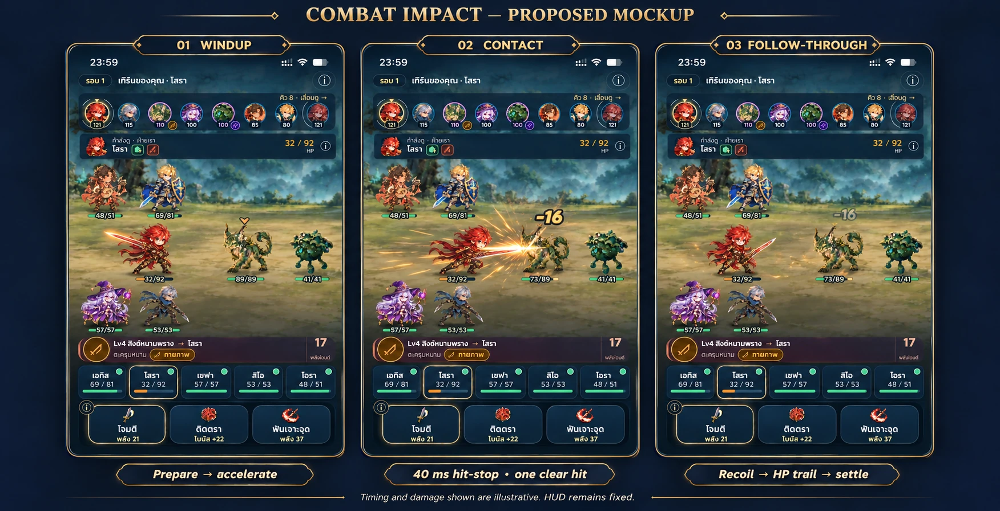
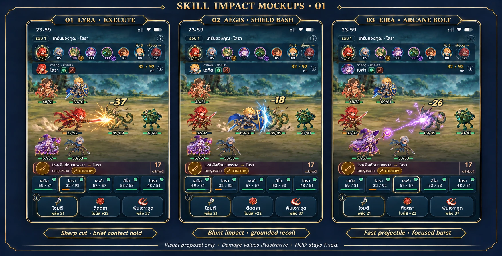
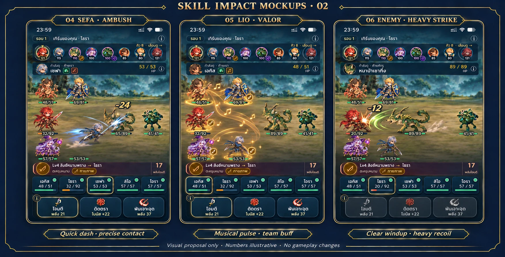

# ART-COMBAT-IMPACT-001 — ข้อเสนอเพิ่มน้ำหนักการต่อสู้

บันทึก 2026-11-14 · [Tracking issue #246](https://github.com/wnau34-nptrn/asterveil-fateweave/issues/246)

## เป้าหมายและสถานะ
เก็บข้อเสนอเพิ่มน้ำหนักการต่อสู้จากการสนทนากับเจ้าของไว้พัฒนาภายหลัง: ง้าง → เร่งเข้าปะทะ → รับแรง → คืนท่า พร้อมดาเมจ/HP ที่อ่านชัด
**เจ้าของอนุญาตให้บันทึกข้อเสนอเท่านั้น ยังไม่ได้สั่งเริ่ม implementation และยังไม่ได้อนุมัติ motion/ตัวเลขเวลา/ความแรงรายสกิล** ไม่เปลี่ยน runtime, rules, saves, balance หรือ deploy เกมในงานนี้

## ภาพ mockup
### จังหวะโจมตี 3 ช่วง

### หลายตัวละคร / หลายสกิล

ภาพสร้างเพื่อสื่อทิศทางเท่านั้น: ชื่อ/portrait/HP/ปุ่ม/selection บางส่วนในภาพยังไม่ตรงข้อมูลจริง อย่าคัดลอกเป็น UI spec หรือ balance; ตัวเลขดาเมจในภาพเป็นตัวอย่าง ภาพไม่ใช่หลักฐานว่าท่าเหล่านี้ทำงานในเกมแล้ว

## ข้อค้นพบจากการตรวจเมื่อ 2026-11-13
อ้างอิง commit `356afdd3b026022784b2721d2ad935695d5985bb` (ไม่ใช่การตรวจยืนยัน HEAD ล่าสุด ณ วันที่บันทึก): เปิด BattleUI/BattleScene/playback/resolver ผ่าน source QA fixture `tests/browser/fixtures/blade.html` ที่ 390×844 ด้วย Chromium และจับภาพตามเวลา
- ตีธรรมดา contact 210 ms / จบ 600 ms; HP ศัตรู 500→484 ตรง contact; ไม่พบ page error ในการจับภาพสองท่า
- มี painted slash, hit reaction และ field shake แล้ว จึงไม่ควรเขียนซ้ำโดยไม่ตรวจของเดิม
- ในฉากที่ตรวจ ผู้โจมตีอยู่ห่างเป้าแต่เอฟเฟกต์เกิดบนเป้า ความเชื่อมโยงอาวุธ→เป้ายังอ่อน; ตัวเลขอยู่เหนือหัวห่างจุดปะทะ
- มีการค้าง release pose ถึง contact อยู่แล้ว แต่ไม่เท่ากับการค้างภาพหลังปะทะที่เสนอ
- เป็นการตรวจ local QA fixture/ภาพตามเวลา ไม่ใช่ production playthrough, การทดสอบ iPhone จริง หรือการรับรองคุณภาพเสียง

## แนวทางพัฒนา
1. ท่าตัวละคร: ง้าง/ฟัน/คืนท่า + รับแรง; ประชิดพุ่งชั่วคราวและคืนช่องเดิม ไม่เปลี่ยน formation/targeting จริง
2. Contact เดียว: อาวุธหรือกระสุนถึงเป้าพร้อมประกาย เสียง ดาเมจ และ HP จริง; ไม่แสดง hit/critical/extra hit เมื่อ resolver ไม่ได้ให้ผลนั้น
3. ทดลอง presentation-only hit-stop: ทั่วไป 30–45 ms, ท่าหนัก 50–70 ms; **เป็นช่วงเสนอเพื่อ A/B ไม่ใช่ค่าล็อกหรือค่าจากเกมอ้างอิง** ตรวจไม่ให้เลื่อน authoritative contact/turn clocks; ถ้ารักษา timing เดิมไม่ได้ให้เสนอทางเลือกก่อน
4. ตัวเลขเด้งครั้งเดียวใกล้เป้า; current/max อัปเดตจริงที่ contact ส่วน delayed HP trail เป็นภาพแยก ไม่เลื่อนค่าจริง
5. แยกเสียงเหวี่ยง/กระแทก/ปลายตามอาวุธ; ต้องฟังจริงร่วมกับ motion ไม่ตัดสินจากภาพนิ่ง
6. HUD อยู่นิ่ง การ์ด HP ฝ่ายเราทั้ง 5 คงเดิม; สี HP เขียว >40%, ส้ม >25–40%, แดง ≤25%; รักษา inspector เจ้าของเทิร์น/เลือกเป้า/เลือกดูเองและ buff/debuff ตามพฤติกรรมที่มีอยู่

| ตัวอย่าง | เอกลักษณ์ที่เสนอ |
|---|---|
| Lyra / Execute | พุ่งสั้น คมดาบเฉียบ จังหวะปะทะกระชับ |
| Aegis / Shield Bash | แรงอัดจากโล่ เป้าสะดุ้งตามทิศ ไม่เพิ่มสถานะจากภาพ |
| Eira / Arcane Bolt | กระสุนจากคทาถึงเป้า ระเบิดเวทเฉพาะจุด |
| Sefa / Ambush | พุ่งต่ำและเร็ว รอยมีดแคบแม่นยำ |
| Lio / Valor | คลื่นเพลงไปถึงทีม ให้ความรู้สึกได้รับพลัง ไม่มีตัวเลขดาเมจ |
| Enemy heavy strike | อ่านท่าง้างได้ ฝ่ายเราผงะเมื่อโดน ไม่มีสถานะ/ท่าใหม่จากภาพโดยอัตโนมัติ |

## แผนเริ่มงานในอนาคต
- [ ] ตรวจ implementation ล่าสุดและขอบเขตกับ Claude ก่อนเริ่ม (Codex เตรียม art ใน incoming; Claude integrate ตามกติกา repo)
- [ ] ทำ playable slice 3 ท่า: attack, Shield Bash, Arcane Bolt ด้วย art เดิมก่อน เพื่อเทียบจังหวะ
- [ ] จับคลิปก่อน/หลัง 390px พร้อมเสียง ให้เจ้าของดู motion ก่อนขยายชุด
- [ ] เมื่อได้จังหวะจึงเตรียม art ท่าง้าง/โจมตี/คืน/รับแรงเพิ่มเฉพาะที่จำเป็น
- [ ] ตรวจ normal/fast, reduced motion/effects, skip/เปลี่ยนเทิร์น และ cleanup
- [ ] ตรวจโดนจริง/บล็อก/ดูดซับ/หลบ/cancel/ตาย/multi-target จาก events จริง
- [ ] ตรวจ boss ใหญ่ยืนกลางแถวหน้ากับมอนบนล่าง, 5v5, ตัวเลขไม่บังชื่อ/HP/ใบหน้า, HUD 5 ใบไม่เปลี่ยน
- [ ] ทดสอบ real mobile และให้เจ้าของอนุมัติ motion ราย batch ก่อนขยายไปทุกสกิล

## อ้างอิง
- [Dead Cells — developer interview](https://www.gamedeveloper.com/design/designing-each-of-the-50-weapons-in-i-dead-cells-i-to-feel-distinctive): น้ำหนักจาก stop frames, slowdown, particles และเสียงประกอบกัน
- [Hades — official patch notes](https://www.supergiantgames.com/blog/hades-updates/): ปรับ on-hit animation, VFX, floating text และความอ่านง่าย
นำหลักการมาปรับใช้ ไม่ยกค่าระยะเวลาหรือ assets จากเกมอื่นมาเป็นสเปก

## ไฟล์และการตรวจ

ภาพทั้งสามเป็น WebP quality 90 ที่ขนาดต้นฉบับประมาณ 1752–1754 × 896–897 px แปลงจาก PNG mockup ในบทสนทนาเพื่อเก็บใน GitHub โดยไม่เปลี่ยนองค์ประกอบ ภาพไม่ใช่ sprite strip หรือ atlas พร้อมใช้

ตรวจ Git blob SHA ของไฟล์ที่ส่งเทียบกับ git hash-object ตรงกันทั้ง 3 ภาพ; ตรวจ diff ให้มีเฉพาะ incoming และบันทึกเอกสาร ไม่มี runtime change จึงไม่รันชุดทดสอบเกมซ้ำในงานบันทึกนี้
