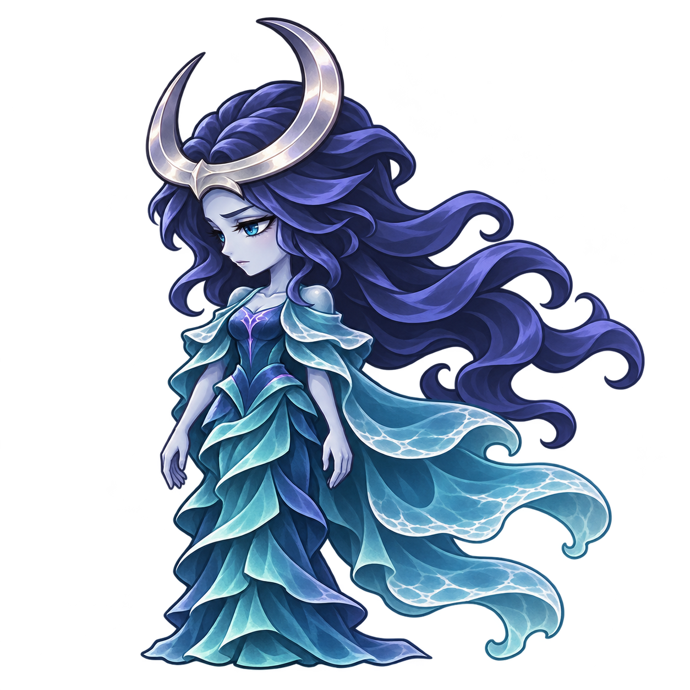

# ภูตธารา · ภาพร่างท่ายืนกึ่ง chibi

เจ้าของเลือกร่างนี้เป็นภาพอ้างอิง โดยให้ความเห็นว่า “ดีกว่าเดิมเยอะเลย” แล้วขอให้บันทึกใน GitHub เมื่อ 2026-11-23

ขยายศีรษะและดวงตา ย่อช่วงตัว และคงสีหน้าเศร้า มงกุฎจันทร์เสี้ยว และชายผ้าที่ไหลเป็นคลื่น ภาพนี้เป็นต้นแบบสำหรับงานตัวบอสและชุดท่ารอบถัดไป

ต้นฉบับ PNG RGBA พื้นหลังโปร่งใส ขนาด 1254×1254 px

SHA-256 `dff1d64c0002bfe247f7b4277d8a3b1b07818f5cab05c2730874ec5c2528433f`
