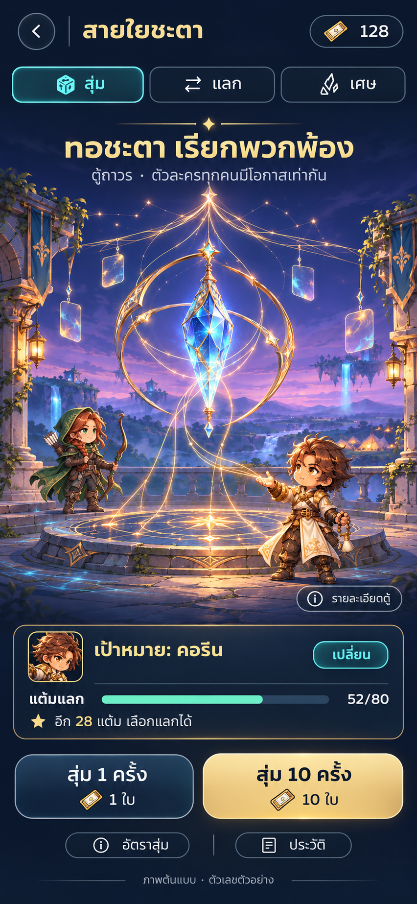
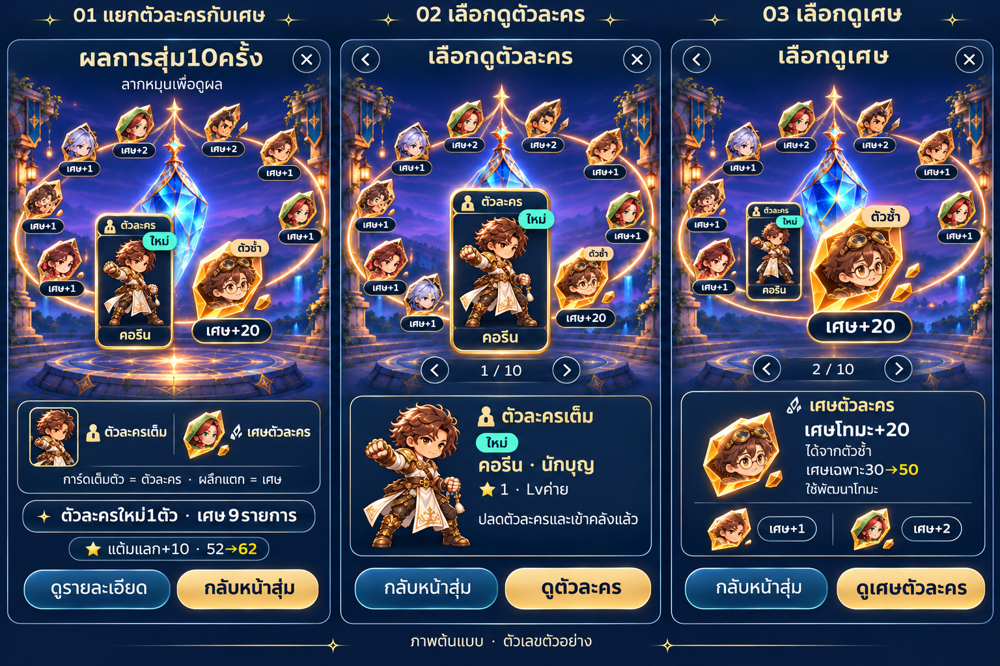

# ภาพอ้างอิงระบบกาชา — ART-UI-GACHA-002

เก็บตามคำขอเจ้าของ9พฤศจิกายน2026: **“นำภาพที่อนุมัติเข้า Github ไว้อ้างอิง”**. ภาพต้นฉบับ11PNG ไม่มีการลดขนาดหรือเปลี่ยนพิกเซล; SHA256/ขนาดอยู่ใน [validation.json](validation.json). ข้อกำหนดส่งต่อและสถานะการเลือกภาพ: [NOTES_TH.md](NOTES_TH.md)

## ตัวอ้างอิงหลักล่าสุด

| ภาพ | ใช้อ้างอิง |
|---|---|
| [หน้ากาชาหลักใหม่](reference/main-screen.png) | ธีม/องค์ประกอบ/แท่นทอชะตาและตำแหน่งUI |
| [วงแหวนและชนิดรางวัล](reference/saturn-ring-reward-types.png) | วงแหวนเอียงแบบดาวเสาร์ที่ตั้งใจให้ลากหมุน; การ์ดตัวเต็มต่างจากผลึกเศษอย่างชัดเจน |
| [ฉากไม่มีUI](art/key-art.png) | ต้นแบบฉากศิลป์ใหม่ |
| [ผลึกพื้นหลังโปร่งใส](art/fate-loom-transparent.png) | วัตถุศิลป์alphaจริง สำหรับพัฒนา/แยกชั้นเอฟเฟกต์ต่อ |
| [จังหวะสุ่มตัวเดียว](reference/single-summon-storyboard.png) | ภาพนิ่ง6ช่วงสำหรับคุยแอนิเมชัน ไม่ใช่คลิปเคลื่อนไหว |

## ภาพขั้นตอน18หน้า — อ้างอิงฟังก์ชันประกอบ

ภาพด้านล่างเป็นแบบก่อนปรับartwork/วงแหวนล่าสุด ให้ใช้ดูขั้นตอนและส่วนควบคุมเท่านั้น **หน้าหลักในชุด01–03และตารางผลใน07–09/16–18ไม่ใช่layoutผลสุ่มหลักแล้ว**; ให้ยึดสองภาพล่าสุดด้านบนเมื่อขัดกัน

| แผ่น | เนื้อหา |
|---|---|
| [01–03](reference/flows/01-03-main-target-preview.png) | หน้าหลักเก่า เลือกเป้าหมาย ดูตัวละคร |
| [04–06](reference/flows/04-06-rates-confirmation.png) | อัตรา ยืนยันสุ่ม1/10ครั้ง |
| [07–09](reference/flows/07-09-summon-results.png) | ตัวใหม่ ตัวซ้ำ ผลรวมแบบเก่า |
| [10–12](reference/flows/10-12-exchange.png) | แลก ยืนยัน รับผล |
| [13–15](reference/flows/13-15-shards-history.png) | เศษ ปลดด้วยเศษ ประวัติ |
| [16–18](reference/flows/16-18-receipt-recovery.png) | รายละเอียดรายการ เน็ตสะดุด ตั๋วไม่พอ |

## ขอบเขต

- **ตัวเลข อัตรา ราคา และยอดในภาพเป็นตัวอย่างทั้งหมด** ไม่ใช่approved balance; ไม่มีSR/SSRหรือเพิ่มraritytier
- ภาพเป็นstatic reference ไม่ใช่UI/วงแหวนที่กดลากได้จริง ไม่ใช่sprite atlasหรือคลิปแอนิเมชัน
- ภาพหลายหน้าเป็นตัวอย่างแยกสถานการณ์ ไม่ใช่บัญชีเดียวที่รับCorinใหม่หลายครั้ง
- ไม่รวมภาพวงแหวนที่ยังแยกตัวกับเศษไม่ได้ หรือรุ่นตาราง10ช่องที่ถูกแทนแล้วเป็นตัวอ้างอิงหลัก
- ไม่มีการแตะsrc/public/rules/save/balance/P09/แพ็กขาย และไม่ได้เริ่มimplementationจากการเก็บภาพนี้
